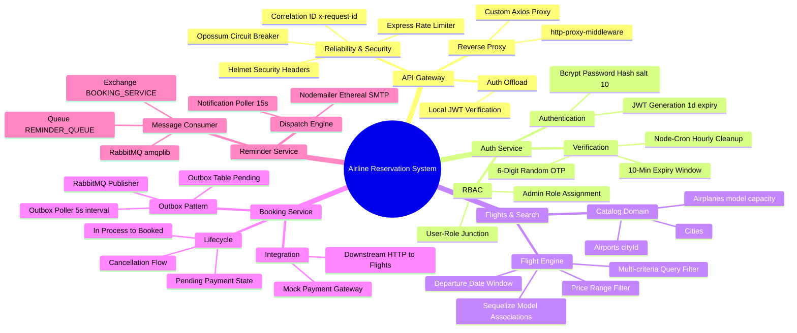
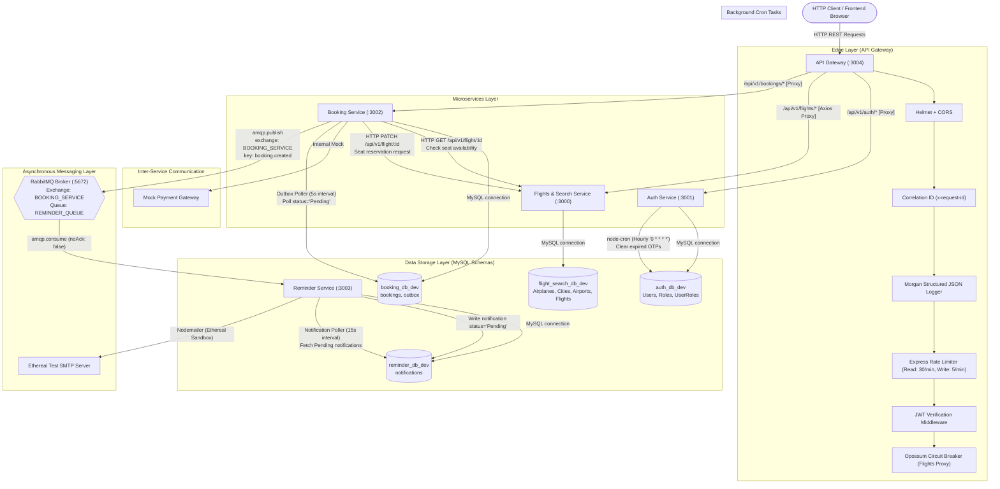
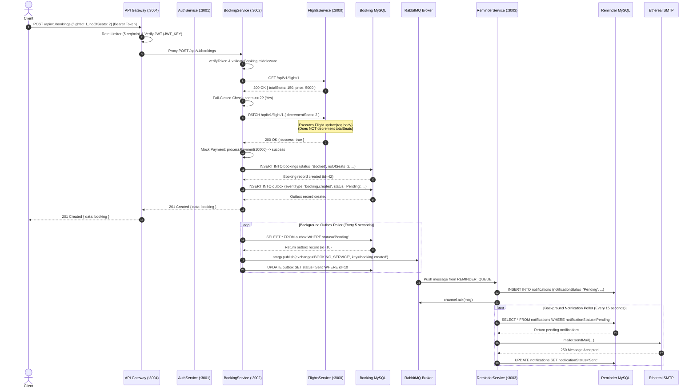
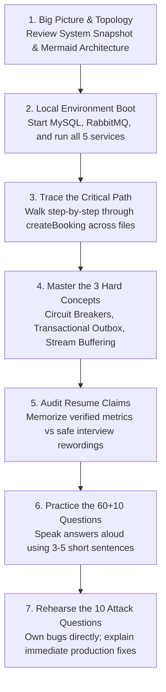

# Airline Reservation System — Learning Guide and Technical Interview Prep

> **Document Type:** Comprehensive Codebase Architecture, Verification Audit, and Technical Interview Preparation Manual  
> **Candidate:** Rohit — B.Tech Software Engineering, Delhi Technological University (DTU)  
> **Target Role:** Software Development Engineer (Backend / Distributed Systems)  
> **Code Repositories Audited:**  
> - Monorepo Workspace: `airline-management-system`  
> - Sub-services: `API_Gateway`, `AuthService`, `BookingService`, `FLIGHTSANDSEARCH`, `ReminderService`  
> - Remote Hub: `https://github.com/Rohit-hub-coder/airline-reservation-system.git`

---

## 1. PROJECT SNAPSHOT

### Executive Summary
The Airline Reservation System is a distributed, service-oriented backend built with Node.js and Express 5. It models the core operations of a commercial airline platform: user identity and access control, flight scheduling and catalog search, seat inventory reservation and booking lifecycle, and automated asynchronous notifications. The system enforces strict service boundary isolation via database-per-service architecture and orchestrates client communication through a reverse-proxy API Gateway equipped with rate limiting and circuit breaking.

### 30-Second Interview Pitch
> "I architected an event-driven Airline Reservation System using Node.js, Express 5, and MySQL, split across five independent microservices. Client traffic enters through a centralized API Gateway that handles path routing, JWT authentication offloading, IP rate limiting, and circuit breaking via Opossum to prevent cascading failures. Booking events are captured via a Transactional Outbox pattern and asynchronously delivered through RabbitMQ message queues to a Reminder Service using Ethereal email sandboxing. The codebase isolates data models with a database-per-service pattern and uses Sequelize ORM migrations for reliable schema versioning."

### What / Why / When Matrix

| Question | Engineering Context |
|---|---|
| **What is it?** | A distributed airline booking platform composed of an API Gateway, Authentication Service, Flights & Search Service, Booking Service, and Reminder Notification Service. |
| **Why was it built?** | To solve domain decoupling and fault isolation in airline workflows. Flight search is high-throughput read-heavy, booking is transaction-critical, and notifications are slow and I/O heavy. Splitting them stops slow SMTP relays or high search loads from degrading booking availability. |
| **When to use microservices here?** | When flight search traffic outnumbers bookings by 100:1, allowing independent autoscaling of the search cluster without over-provisioning booking databases or notification workers. |
| **When NOT to use microservices here?** | For an early-stage startup or low-traffic regional carrier. Monolithic architectures eliminate distributed transactions, network latency across hops, outbox polling overhead, and operational complexity. |

### Domain Architecture Mindmap



---

## 2. TECH STACK

This table lists every runtime, library, and framework strictly verified from `package.json` files across all five services.

| Layer | Technology | Exact Version in Repo | Why Chosen | One Alternative & Trade-off |
|---|---|---|---|---|
| **HTTP Runtime** | Node.js / Express | `express@^5.2.1` | Native async error handling, modern middleware piping, lightweight event loop. | **Fastify**: Faster JSON serialization and built-in schema validation, but smaller ecosystem and different middleware lifecycle. |
| **Relational Database** | MySQL | `mysql2@^3.22.6` (Flights), `^3.23.1` (Auth, Booking, Reminder) | ACID compliance, battle-tested row locking, predictable relational schema for flight inventory. | **PostgreSQL**: Native `FOR UPDATE SKIP LOCKED` for outbox polling and better JSON query operators, but higher baseline memory usage. |
| **Object-Relational Mapping (ORM)** | Sequelize | `sequelize@^6.37.8`, `sequelize-cli@^6.6.5` | Programmatic schema migrations, association abstractions (`belongsTo`, `belongsToMany`), connection pooling. | **Prisma**: Type-safe query generation and cleaner schema syntax, but heavier binary engine and less flexible raw SQL overrides. |
| **Message Broker** | RabbitMQ | `amqplib@^2.0.1` | AMQP protocol compliance, lightweight memory footprint, durable queue persistence, direct topic exchange routing. | **Apache Kafka**: High-throughput distributed log with replayable offsets, but requires ZooKeeper/KRaft coordination and heavy partition management. |
| **Circuit Breaker** | Opossum | `opossum@^10.0.0` | In-process failure threshold tracking, automatic timeout handling, and half-open state testing for HTTP proxies. | **Resilience4j / Envoy Proxy**: Infrastructure-level circuit breaking without application code, but requires running dedicated sidecar proxies. |
| **Rate Limiting** | Express-Rate-Limit | `express-rate-limit@^7.5.1` | In-memory token bucket tracking per IP address, preventing resource exhaustion on public endpoints. | **Redis Token Bucket**: Distributed rate limiting across multi-instance gateways, but adds a Redis cache dependency and network hop. |
| **Authentication & Tokens** | JSON Web Tokens | `jsonwebtoken@^9.0.3` | Stateless authorization, zero database lookups on authenticated gateway requests, verifiable signature. | **Paseto / Redis Sessions**: Immediate token revocation and opaque credentials, but requires centralized session store queries on every request. |
| **Password Hashing** | Bcrypt | `bcrypt@^6.0.0` | Adaptive key derivation with salted hashing (salt rounds: 10), resilient to rainbow table attacks. | **Argon2**: Memory-hard password hashing immune to GPU/ASIC attacks, but requires native C++ toolchain compilation. |
| **Email Dispatcher** | Nodemailer | `nodemailer@^9.0.5` | Simple SMTP client with built-in integration for Ethereal disposable test accounts. | **SendGrid / AWS SES SDK**: High-deliverability transactional cloud API, but requires external domain verification and cloud API keys. |
| **Scheduled Tasks** | Node-Cron | `node-cron@^4.6.0` | Native cron syntax string parsing for background job scheduling inside single Node process. | **Agenda / BullMQ**: Distributed Redis-backed task queue with retry backoff, but introduces Redis infrastructure dependency. |
| **Security Headers** | Helmet | `helmet@^8.1.0` | Sets 15+ HTTP response headers (HSTS, CSP, X-Frame-Options) to mitigate common web attacks. | **Custom Middleware**: Zero dependencies, but high maintenance and prone to missing emergent security standards. |
| **HTTP Logging** | Morgan | `morgan@^1.10.0` | Streamlined access logging formatted as structured JSON including response times and correlation IDs. | **Pino-Http**: Faster JSON serialization and lower event-loop overhead, but requires logger restructuring. |
| **HTTP Client** | Axios | `axios@^1.7.9` (Booking), `^1.19.0` (Gateway) | Promise-based request execution, interceptor support, automatic JSON payload serialization. | **Undici / Native fetch**: Zero external dependencies in modern Node.js, but requires manual timeout signal setup and response JSON parsing. |
| **Unit Testing** | Jest & Supertest | `jest@^29.7.0`, `supertest@^7.1.0` (Booking only) | Native mock capabilities (`jest.fn()`, `jest.mock()`), fast runner with assertion libraries. | **Mocha + Chai + Sinon**: Highly modular, but requires configuring multiple separate libraries. |

---

## 3. ARCHITECTURE

### Architecture Style
Distributed Microservices with Database-per-Service, Reverse-Proxy API Gateway, and Asynchronous Message Queuing via Transactional Outbox.

### High-Level Design (HLD) Flowchart



### Folder Tree and Key Files Purpose

```
airline-management-system/
├── API_Gateway/
│   ├── .env.example                       # Gateway environment template
│   ├── package.json                       # Express 5, Opossum, RateLimit, http-proxy-middleware
│   └── src/
│       ├── index.js                       # Main gateway entry point, proxy routing, circuit breaker
│       ├── config/
│       │   └── serverConfig.js            # Port bindings, downstream service URLs, JWT secret
│       ├── middlewares/
│       │   └── auth-middleware.js         # JWT Bearer token verification at the gateway
│       └── utils/
│           ├── logger.js                  # Structured JSON stdout logger (info, warn, error)
│           └── errors/
│               └── index.js               # Error re-exporter (References non-existent app-error.js)
│
├── AuthService/
│   ├── .env.example                       # Auth database, SMTP, and server port configs
│   ├── package.json                       # Express 5, Sequelize, bcrypt, jsonwebtoken, node-cron
│   └── src/
│       ├── index.js                       # Server boot, DB sync hook, cron job trigger
│       ├── config/
│       │   ├── config.js                  # Sequelize database connection configuration
│       │   └── serverConfig.js            # Port, bcrypt salt, and JWT key configs
│       ├── controllers/
│       │   └── user-controller.js         # Request handlers for signup, signin, OTP, profile, roles
│       ├── middlewares/
│       │   ├── auth-middleware.js         # JWT verification for protected routes
│       │   ├── authorize-middleware.js    # Role-based access control (RBAC) middleware
│       │   ├── signin-middleware.js       # Validates email and password presence
│       │   └── signup-middleware.js       # Validates signup request payload
│       ├── migrations/
│       │   ├── 20260725042942-create-user.js        # Base Users table migration
│       │   ├── 20260725063359-add-otp-fields.js     # Adds otp, otpExpiry, isVerified columns
│       │   ├── 20260725143135-create-role.js        # Roles table migration
│       │   ├── 20260725152822-add-roleId.js         # Adds roleId column to users table
│       │   └── 20260725154036-create-user-role.js   # UserRoles junction table migration
│       ├── models/
│       │   ├── index.js                   # Sequelize model loader and association registry
│       │   ├── role.js                    # Role model schema definition
│       │   └── user.js                    # User model with beforeCreate bcrypt hashing hook
│       ├── repository/
│       │   └── user-repo.js               # SQL queries via Sequelize for Users and Roles
│       ├── routes/
│       │   ├── index.js                   # Mounts /v1 routes
│       │   └── v1/index.js                # Endpoints for signup, signin, verify-otp, roles
│       ├── seeders/
│       │   ├── 20260720160053-demo-seed.js          # Demo seed data
│       │   └── 20260725152238-add-roles.js          # Seeds default 'admin' and 'customer' roles
│       ├── services/
│       │   └── user-service.js            # Business logic: OTP generation, signin checks, token creation
│       └── utils/
│           ├── client-error.js            # Custom 4xx operational error wrapper
│           ├── error-handler.js           # Base AppError class with stack capture
│           ├── otp-cleanup.js             # Hourly node-cron job clearing expired OTPs from MySQL
│           ├── send-email.js              # Gmail SMTP sender for OTP dispatch (Missing package dependency)
│           └── validation-error.js        # Maps Sequelize validation errors to HTTP 400
│
├── BookingService/
│   ├── .env.example                       # Booking DB, RabbitMQ broker, and Flights URL config
│   ├── Dockerfile                         # Node 20 alpine container build definition
│   ├── docker-compose.yml                 # Local dev compose setup (Booking + MySQL + Nginx stub)
│   ├── package.json                       # Express 5, Sequelize, amqplib, Jest, Supertest
│   ├── tests/
│   │   ├── booking-service.test.js        # Mocked unit test for fail-closed flight seat check
│   │   ├── payment-flow.test.js           # Mocked unit test for payment failure seat rollback
│   │   └── validation.test.js             # Supertest integration test for validateBooking middleware
│   └── src/
│       ├── index.js                       # Express app bootstrap, outbox poller initiator
│       ├── config/
│       │   ├── config.js                  # Database connection settings per environment
│       │   └── serverConfig.js            # Service port, RabbitMQ exchange, Flights path
│       ├── controllers/
│       │   └── booking-controller.js      # Handles create, read, list, and cancel booking endpoints
│       ├── middlewares/
│       │   ├── auth-middleware.js         # Decodes JWT and attaches req.user
│       │   └── validate-booking.js        # Validates positive flightId and noOfSeats (1..10)
│       ├── migrations/
│       │   ├── 20260726120000-create-bookings.js    # Creates bookings table with ENUM status
│       │   ├── 20260726130000-create-outbox.js      # Creates outbox table for event publishing
│       │   └── 20260726140000-add-pending-payment.js# Alters status ENUM to include 'Pending Payment'
│       ├── models/
│       │   ├── index.js                   # Sequelize DB connection and model initialization
│       │   ├── booking.js                 # Booking model definition
│       │   └── outbox.js                  # Outbox model definition
│       ├── repository/
│       │   └── booking-repository.js      # Database operations for Booking model
│       ├── routes/
│       │   ├── index.js                   # Health checks (/health, /ready) and /v1 mount
│       │   └── v1/index.js                # Protected booking CRUD endpoints
│       ├── services/
│       │   ├── booking-service.js         # Core booking transaction: flight verification, payment, outbox
│       │   └── payment-service.js         # Mock payment processor returning static success
│       └── utils/
│           ├── messageQueue.js            # RabbitMQ channel management and publishMessage helper
│           ├── outboxPoller.js            # 5-second interval poller sending outbox events to RabbitMQ
│           └── errors/
│               ├── app-error.js           # Operational error abstraction
│               ├── index.js               # Errors aggregator
│               └── validation-error.js    # Validation error wrapper
│
├── FLIGHTSANDSEARCH/
│   ├── .env.example                       # Contains only PORT variable definition
│   ├── package.json                       # Express 5, Sequelize, mysql2, body-parser
│   └── src/
│       ├── index.js                       # Flight service listener on PORT
│       ├── config/
│       │   ├── config.json                # Hardcoded database credentials (username/password)
│       │   └── serverConfig.js            # Extracts process.env.PORT
│       ├── controllers/
│       │   ├── airplane-controller.js     # Airplane CRUD handlers
│       │   ├── airport-controller.js      # Airport CRUD handlers
│       │   ├── city-controller.js         # City CRUD and getAirportsOfCity handlers
│       │   └── flight-controller.js       # Flight CRUD and search query handlers
│       ├── middlewares/
│       │   ├── airplane-middlewares.js    # Validates airplane creation payload
│       │   ├── airport-middlewares.js     # Validates airport creation payload
│       │   ├── city-middlewares.js        # Validates city creation payload
│       │   └── flight-middlewares.js      # Validates flight creation payload
│       ├── migrations/
│       │   ├── 20260710140657-create-city.js        # Creates Cities table
│       │   ├── 20260712152903-create-airport.js     # Creates Airports table with cityId foreign key
│       │   ├── 20260714082927-create-airplane.js    # Creates Airplanes table with capacity
│       │   └── 20260714091325-create-flight.js      # Creates Flights table with airport/airplane foreign keys
│       ├── models/
│       │   ├── index.js                   # Sequelize model loader and relationship builder
│       │   ├── airplane.js                # Airplane model definition
│       │   ├── airport.js                 # Airport model with belongsTo City
│       │   ├── city.js                    # City model with hasMany Airports
│       │   └── flight.js                  # Flight model with associations to Airplane and Airports
│       ├── repository/
│       │   ├── crud-repo.js               # Generic base repository implementing CRUD methods
│       │   ├── airplane-repo.js           # Airplane-specific repository extending CrudRepository
│       │   ├── airport-repo.js            # Airport-specific repository extending CrudRepository
│       │   ├── city-repo.js               # City-specific repository extending CrudRepository
│       │   ├── flight-repo.js             # Flight repository with complex Op filtering and joins
│       │   └── index.js                   # Exports all repositories
│       ├── routes/
│       │   ├── index.js                   # Mounts /v1 routes
│       │   └── v1/index.js                # 21 REST routes for flights, cities, airports, airplanes
│       ├── seeders/
│       │   ├── 20260712092252-seed-cities.js        # Seeds default cities
│       │   ├── 20260712192938-add-airports.js       # Seeds default airports
│       │   ├── 20260714090015-add-airplanes.js      # Seeds default airplane fleet
│       │   └── manual_flights_seeder.js             # Raw script for seeding flights
│       ├── services/
│       │   ├── crud-service.js            # Generic base service wrapping CrudRepository
│       │   ├── airplane-service.js        # Airplane service extending CrudService
│       │   ├── airport-service.js         # Airport service extending CrudService
│       │   ├── city-service.js            # City service extending CrudService
│       │   ├── flight-service.js          # Flight service with time validation logic
│       │   └── index.js                   # Exports all services
│       └── utils/
│           ├── error-codes.js             # Object freezing HTTP status codes
│           └── helper.js                  # Time comparison and date validation functions
│
└── ReminderService/
    ├── .env.example                       # DB credentials, broker URL, exchange name
    ├── package.json                       # Express 5, amqplib, nodemailer, sequelize
    ├── migrations/
    │   └── 20260811000100-create-notifications.js   # Creates notifications table
    └── src/
        ├── index.js                       # Starts RabbitMQ consumer and notification poller
        ├── config/
        │   ├── config.js                  # Sequelize MySQL database configuration
        │   └── serverConfig.js            # Server PORT, RabbitMQ, and DB environment variables
        ├── models/
        │   ├── index.js                   # Initializes Notification model
        │   └── notification.js            # Notification model schema definition
        ├── repository/
        │   └── index.js                   # Empty repository file
        ├── routes/
        │   └── index.js                   # Liveness endpoint (/health)
        ├── services/
        │   └── notification-service.js    # Initializes Ethereal SMTP transporter and sends email
        └── utils/
            ├── notificationPoller.js      # 15-second interval poller dispatching pending emails
            └── rabbitConsumer.js          # Consumes booking.created events and inserts DB records
```

### Call Hierarchy: Which File Calls Which

1. **Client Request to API Gateway:**
   - Incoming request hits `API_Gateway/src/index.js`.
   - Passes through `helmet()`, `cors()`, correlation ID middleware (generates `x-request-id`), `morgan()` structured logger.
   - For `/api/v1/auth/*`: Evaluates `readRateLimiter` -> delegates to `authProxy` (`http-proxy-middleware`) -> calls `AuthService` (`http://localhost:3001/api/v1/*`).
   - For `/api/v1/flights/*`: Evaluates `readRateLimiter` -> executes `customFlightProxy` -> passes through `flightBreaker` (`opossum`) -> executes Axios call with exponential retry to `FLIGHTSANDSEARCH` (`http://localhost:3000/api/v1/*`).
   - For `/api/v1/bookings/*`: Evaluates `writeRateLimiter` -> executes `verifyToken` (`API_Gateway/src/middlewares/auth-middleware.js`) -> delegates to `bookingProxy` -> calls `BookingService` (`http://localhost:3002/api/v1/bookings/*`).

2. **Booking Flow Inside BookingService:**
   - `BookingService/src/index.js` mounts routes via `src/routes/index.js` -> `src/routes/v1/index.js`.
   - `POST /api/v1/bookings` hits `verifyToken` (`BookingService/src/middlewares/auth-middleware.js`), which validates JWT and assigns `req.user`.
   - Passes to `validateBooking` (`BookingService/src/middlewares/validate-booking.js`) to assert `flightId` and `noOfSeats` validity.
   - Calls `bookingController.createBooking` (`BookingService/src/controllers/booking-controller.js`).
   - Calls `BookingService.createBooking` (`BookingService/src/services/booking-service.js`).
   - `BookingService` executes HTTP `axios.get` to `FLIGHTSANDSEARCH` (`${FLIGHT_SERVICE_PATH}/${flightId}`).
   - `BookingService` executes HTTP `axios.patch` to `FLIGHTSANDSEARCH`.
   - `BookingService` calls `PaymentService.processPayment` (`BookingService/src/services/payment-service.js`).
   - `BookingService` calls `BookingRepository.create` (`BookingService/src/repository/booking-repository.js`) -> writes to `bookings` table.
   - `BookingService` calls `Outbox.create` (`BookingService/src/models/outbox.js`) -> writes to `outbox` table.

3. **Asynchronous Notification Flow:**
   - `outboxPoller.js` in `BookingService` queries `Outbox.findAll({ where: { status: 'Pending' } })`.
   - Calls `publishMessage` (`BookingService/src/utils/messageQueue.js`) -> publishes JSON payload to RabbitMQ exchange `BOOKING_SERVICE` with routing key `booking.created`.
   - Updates `Outbox` status to `'Sent'`.
   - `rabbitConsumer.js` in `ReminderService` consumes message from `REMINDER_QUEUE` -> calls `Notification.create` in `ReminderService/src/models/notification.js`.
   - Acknowledges message with `channel.ack(msg)`.
   - `notificationPoller.js` in `ReminderService` queries `Notification.findAll({ where: { notificationStatus: 'Pending' } })`.
   - Calls `sendNotification` in `ReminderService/src/services/notification-service.js` -> connects to Ethereal SMTP via `nodemailer` and sends email.
   - Updates `Notification` status to `'Sent'`.

---

## 4. END-TO-END FLOW: SEAT BOOKING LIFECYCLE

The primary transaction in the system is creating a flight reservation, verifying availability, processing mock payment, persisting state, and triggering outbox notification.

### Numbered Step-by-Step Flow

1. **Client Submission:** The client issues an HTTP `POST` to `http://localhost:3004/api/v1/bookings` containing headers `{ "Authorization": "Bearer <JWT>", "Content-Type": "application/json" }` and body `{ "flightId": 1, "noOfSeats": 2 }`.
2. **Gateway Pre-processing:** `API_Gateway/src/index.js` assigns an `x-request-id` UUID header, records request start time in Morgan, and checks `writeRateLimiter` (max 5 write requests per minute per IP).
3. **Gateway Auth Verification:** `API_Gateway/src/middlewares/auth-middleware.js` verifies the JWT signature against `JWT_KEY`. If valid, request passes to `bookingProxy`.
4. **Proxy Forwarding:** `http-proxy-middleware` strips the mount path and proxies the request to `BookingService` at `http://localhost:3002/api/v1/bookings`.
5. **Booking Service Ingestion:** `BookingService/src/routes/v1/index.js` intercepts the request.
6. **Downstream Auth Check:** `BookingService/src/middlewares/auth-middleware.js` re-verifies the JWT using `BookingService`'s `JWT_KEY` and injects `req.user = decoded` into the request context.
7. **Input Validation:** `BookingService/src/middlewares/validate-booking.js` verifies that `flightId` is a positive integer and `noOfSeats` is between 1 and 10.
8. **Flight Availability Verification (Read):** `BookingService.createBooking` in `BookingService/src/services/booking-service.js` makes an HTTP `GET` call via Axios to `FLIGHTSANDSEARCH` at `${FLIGHT_SERVICE_PATH}/1`.
9. **Fail-Closed Verification:** `booking-service.js` checks if the response contains `totalSeats` or `availableSeats`. If missing or non-numeric, it throws an `AppError` with status code 503 (`SERVICE_UNAVAILABLE`). If `availableSeats < noOfSeats`, it throws status code 409 (`CONFLICT`).
10. **Seat Reservation (Write):** `booking-service.js` makes an HTTP `PATCH` call to `FLIGHTSANDSEARCH` passing `{ decrementSeats: 2, reserveIfAvailable: true, reason: 'booking-reservation' }`.
11. **Payment Execution:** `booking-service.js` sets status to `'Pending Payment'` and calls `paymentService.processPayment(totalCost)` (`BookingService/src/services/payment-service.js`). The mock service returns `{ success: true }`.
12. **Booking Persistence:** `booking-service.js` sets status to `'Booked'` and calls `bookingRepository.create()` (`BookingService/src/repository/booking-repository.js`), inserting a row into MySQL `bookings`.
13. **Outbox Persistence:** `booking-service.js` calls `Outbox.create()` (`BookingService/src/models/outbox.js`), inserting an event into MySQL `outbox` with `eventType: 'booking.created'` and `status: 'Pending'`.
14. **Client Response:** The Gateway returns HTTP 201 `CREATED` with the booking object to the client.
15. **Outbox Polling:** Every 5 seconds, `outboxPoller.js` polls MySQL for records where `status = 'Pending'`.
16. **Broker Publishing:** `messageQueue.js` publishes the payload over AMQP to RabbitMQ exchange `BOOKING_SERVICE` with routing key `booking.created`. The outbox row status is updated to `'Sent'`.
17. **Queue Consumption:** `ReminderService/src/utils/rabbitConsumer.js` consumes the message from `REMINDER_QUEUE` and writes a new row into `notifications` with `notificationStatus: 'Pending'`. It then calls `channel.ack(msg)`.
18. **Email Dispatch:** Every 15 seconds, `ReminderService/src/utils/notificationPoller.js` polls for notifications where `notificationStatus = 'Pending'`, and triggers `sendNotification()` (`ReminderService/src/services/notification-service.js`) via Nodemailer Ethereal sandbox, updating status to `'Sent'`.

### Sequence Diagram



---

## 5. DEEP DIVE PER MODULE

### Module 1: API Gateway
- **Purpose:** Centralized ingress proxy offloading security, rate limiting, logging, and routing.
- **Key Functions:**
  - `customFlightProxy(req, res, next)`: Custom Axios reverse-proxy with body streaming and header mapping.
  - `flightBreaker.fire(reqOpts)`: Circuit-breaker wrapper tracking failure rates.
  - `asyncRetry(fn, retries, delay)`: Exponential backoff retry handler for transient 5xx errors.
  - `verifyToken(req, res, next)`: Gateway JWT validation middleware.
- **Inputs & Outputs:** Inputs: HTTP request stream, headers, JWT. Outputs: Reverse-proxied downstream responses or standardized 401/429/503 JSON errors.
- **Internal Logic:** Verifies correlation ID or generates UUID. Parses stream chunks only for non-GET requests so that `http-proxy-middleware` does not hang on empty consumed streams.
- **Design Pattern:** API Gateway Pattern, Circuit Breaker Pattern, Proxy Pattern.
- **Edge Cases:** If a downstream service drops the TCP connection, `asyncRetry` retries twice (200ms, then 400ms delay) before the circuit breaker registers a failure.

### Module 2: Authentication Service (`AuthService`)
- **Purpose:** User registration, credential authentication, OTP email verification, and RBAC management.
- **Key Functions:**
  - `createUser(data)`: Hashes password, generates a 6-digit OTP, sets a 10-minute expiry, and creates user.
  - `signIn(email, plainPassword)`: Verifies user is verified, checks bcrypt hash, and issues JWT with roles array.
  - `verifyOTP(email, enteredOtp)`: Compares trimmed OTP strings and checks expiry timestamp.
  - `startOTPCleanupJob()`: Runs hourly cron job clearing expired OTPs.
  - `assignRole(userId, roleId)`: Populates `UserRoles` join table.
- **Inputs & Outputs:** Inputs: Email, plaintext password, OTP string, role ID. Outputs: JWT string, user profile object, confirmation messages.
- **Internal Logic:** Password hashing occurs in a Sequelize `beforeCreate` hook using `bcrypt.genSaltSync(10)`. OTP comparison uses `String(storedOTP).trim() === String(receivedOTP).trim()`.
- **Design Pattern:** Repository Pattern, Service Layer Pattern, Role-Based Access Control (RBAC).
- **Edge Cases:** Unverified users attempting signin receive HTTP 401 `NotVerified`. Expired OTPs receive HTTP 400 `OTPExpired`.

### Module 3: Flights & Search Service (`FLIGHTSANDSEARCH`)
- **Purpose:** Inventory management for airplanes, airports, cities, and flight search query filtering.
- **Key Functions:**
  - `flightRepository.getFlights(filterData)`: Dynamic Sequelize query construction using `Op.and`, `Op.gte`, `Op.lte`.
  - `flightService.create(data)`: Validates that arrival time is strictly after departure time and departure time is in the future.
  - `crudRepository.update(id, data)`: Generic row updater.
- **Inputs & Outputs:** Inputs: Flight scheduling parameters, search filter query params (`departureAirportId`, `arrivalAirportId`, `minPrice`, `maxPrice`, `departureDate`). Outputs: Filtered flight arrays with joined airplane and airport associations.
- **Internal Logic:** Date query spans an exact 24-hour range (`[Op.gte]: startDate`, `[Op.lt]: endDate.setDate(startDate.getDate() + 1)`).
- **Design Pattern:** Generic Repository Pattern (`CrudRepository`), Inheritance (`FlightRepository extends CrudRepository`).
- **Edge Cases:** Non-numeric airport IDs or past departure dates throw validation errors prior to database execution.

### Module 4: Booking Service (`BookingService`)
- **Purpose:** Validates seat inventory, executes mock payment, creates bookings, and enqueues transactional outbox records.
- **Key Functions:**
  - `createBooking(bookingData)`: Orchestrates availability verification, seat decrement PATCH, payment, booking insert, and outbox insert.
  - `cancelBooking(userId, bookingId)`: Verifies user ownership, calls Flights service seat increment PATCH, and updates status to `'Cancelled'`.
  - `pollOutbox()`: Background worker polling pending outbox records and dispatching to RabbitMQ.
- **Inputs & Outputs:** Inputs: Authenticated `userId`, `flightId`, `noOfSeats`. Outputs: Created booking record.
- **Internal Logic:** Validates `totalSeats` existence. If absent, terminates immediately with 503 fail-closed error.
- **Design Pattern:** Transactional Outbox Pattern, Fail-Closed Pattern, Service Layer Pattern.
- **Edge Cases:** If user attempts to fetch or cancel a booking owned by another `userId`, the service returns HTTP 403 `Forbidden`.

### Module 5: Reminder Service (`ReminderService`)
- **Purpose:** Asynchronous notification processor consuming RabbitMQ booking events and sending email confirmations.
- **Key Functions:**
  - `startConsumer()`: Connects to RabbitMQ, asserts `BOOKING_SERVICE` exchange, asserts `REMINDER_QUEUE`, binds routing key `booking.created`, and processes messages.
  - `pollPendingNotifications()`: Scans `notifications` table for `Pending` records and sends emails via Nodemailer.
  - `sendNotification(notification)`: Generates Ethereal test SMTP credentials and dispatches HTML email.
- **Inputs & Outputs:** Inputs: AMQP message buffer containing JSON `{ bookingId, userId, status }`. Outputs: MySQL notification record and Ethereal email dispatch.
- **Internal Logic:** Consumer saves notification with `notificationStatus: 'Pending'` and acks the RabbitMQ message immediately. Poller iterates every 15s to deliver emails.
- **Design Pattern:** Competing Consumers Pattern, Event-Driven Architecture, Polling Consumer Pattern.
- **Edge Cases:** If Nodemailer throws an error, `sendNotification` logs error and returns `false`.

---

## 6. DATA LAYER

### Database Architecture
The platform implements a strict **Database-per-Service** architecture using MySQL 8. Schemas are completely isolated; no service holds foreign keys referencing another service's database tables. Cross-service relationships exist purely through loose application-level identifiers (`userId`, `flightId`, `bookingId`).

### Entity-Relationship Diagram

```mermaid
erDiagram
    %% AuthService Database (auth_db_dev)
    subgraph AuthService_DB ["Auth Service Database (auth_db_dev)"]
        USERS {
            int id PK
            varchar name
            varchar email UK
            varchar password
            varchar otp
            datetime otpExpiry
            boolean isVerified
            datetime createdAt
            datetime updatedAt
        }
        ROLES {
            int id PK
            varchar name
            datetime createdAt
            datetime updatedAt
        }
        USER_ROLES {
            int id PK
            int userId FK
            int roleId FK
            datetime createdAt
            datetime updatedAt
        }
        USERS ||--o{ USER_ROLES : "has roles"
        ROLES ||--o{ USER_ROLES : "assigned to"
    end

    %% Flights Service Database (flight_search_db_dev)
    subgraph FlightsService_DB ["Flights Service Database (flight_search_db_dev)"]
        AIRPLANES {
            int id PK
            varchar model
            int capacity
            datetime createdAt
            datetime updatedAt
        }
        CITIES {
            int id PK
            varchar name UK
            datetime createdAt
            datetime updatedAt
        }
        AIRPORTS {
            int id PK
            varchar name
            varchar address
            int cityId FK
            datetime createdAt
            datetime updatedAt
        }
        FLIGHTS {
            int id PK
            varchar flightNumber
            int airplaneId FK
            int departureAirportId FK
            int arrivalAirportId FK
            datetime arrivalTime
            datetime departureTime
            int price
            varchar boardingGate
            int totalSeats
            datetime createdAt
            datetime updatedAt
        }
        CITIES ||--o{ AIRPORTS : "contains"
        AIRPLANES ||--o{ FLIGHTS : "operates"
        AIRPORTS ||--o{ FLIGHTS : "departs from"
        AIRPORTS ||--o{ FLIGHTS : "arrives at"
    end

    %% Booking Service Database (booking_db_dev)
    subgraph BookingService_DB ["Booking Service Database (booking_db_dev)"]
        BOOKINGS {
            int id PK
            int flightId "Logical FK -> FLIGHTS.id"
            int userId "Logical FK -> USERS.id"
            enum status "In Process, Pending Payment, Booked, Cancelled"
            int noOfSeats
            float totalCost
            datetime createdAt
            datetime updatedAt
        }
        OUTBOX {
            int id PK
            varchar eventType
            text payload
            enum status "Pending, Sent"
            datetime createdAt
            datetime updatedAt
        }
        BOOKINGS ..o{ OUTBOX : "triggers event"
    end

    %% Reminder Service Database (reminder_db_dev)
    subgraph ReminderService_DB ["Reminder Service Database (reminder_db_dev)"]
        NOTIFICATIONS {
            int id PK
            int bookingId "Logical FK -> BOOKINGS.id"
            int userId "Logical FK -> USERS.id"
            varchar status
            varchar notificationStatus "Pending, Sent, Failed"
            text message
            datetime createdAt
            datetime updatedAt
        }
    end
```

### Schema, Relations, Transactions & Indexes Breakdown

| Service | Table | Primary Key | Foreign Keys / Constraints | Indexes Present | Transactions Used? |
|---|---|---|---|---|---|
| **AuthService** | `Users` | `id` (INT Auto) | `email` (UNIQUE) | Primary key index on `id`, unique index on `email`. | **None in code**. `user.save()` and `User.update()` run without `sequelize.transaction()`. |
| **AuthService** | `Roles` | `id` (INT Auto) | None | Primary key index on `id`. | None. |
| **AuthService** | `UserRoles` | `id` (INT Auto) | `userId` references `Users(id)` ON DELETE CASCADE, `roleId` references `Roles(id)` ON DELETE CASCADE. | Primary key index on `id`, foreign key indexes on `userId` and `roleId`. | None. |
| **FlightsService** | `Airplanes` | `id` (INT Auto) | None | Primary key index on `id`. | None. |
| **FlightsService** | `Cities` | `id` (INT Auto) | `name` (UNIQUE in migration) | Primary key index on `id`, unique index on `name`. | None. |
| **FlightsService** | `Airports` | `id` (INT Auto) | `cityId` references `Cities(id)` ON DELETE CASCADE. | Primary key index on `id`, foreign key index on `cityId`. | None. |
| **FlightsService** | `Flights` | `id` (INT Auto) | `airplaneId` -> `Airplanes(id)`, `departureAirportId` -> `Airports(id)`, `arrivalAirportId` -> `Airports(id)` (All CASCADE). | Primary key index on `id`, foreign key indexes on airplane and airport columns. **NO index on price or departureTime**. | None. |
| **BookingService** | `bookings` | `id` (INT Auto) | Logical `flightId`, `userId`. ENUM: `'In Process'`, `'Pending Payment'`, `'Booked'`, `'Cancelled'`. | Primary key index on `id`. **NO index on `userId` or `status`**. | **None in code**. Booking creation and outbox row creation are NOT wrapped in a transaction. |
| **BookingService** | `outbox` | `id` (INT Auto) | None. ENUM: `'Pending'`, `'Sent'`. | Primary key index on `id`. **NO index on `status`** (Causes full table scan on every 5s poll). | None. |
| **ReminderService**| `notifications` | `id` (INT Auto) | Logical `bookingId`, `userId`. | Primary key index on `id`. **NO unique index on `bookingId`** (Permits duplicate email rows). **NO index on `notificationStatus`**. | None. |

---

## 7. API AND INTERFACES

### Exact Endpoint Counts
- **API Gateway Direct Endpoints:** 2
- **AuthService Endpoints:** 6
- **BookingService Endpoints:** 7
- **FLIGHTSANDSEARCH Endpoints:** 22
- **ReminderService Endpoints:** 2
- **Total Unique Endpoints Implemented in Codebase:** **39 endpoints**
- **Total Endpoints Reachable Through API Gateway:** **34 endpoints** (2 Gateway direct + 6 Auth + 22 Flights + 4 Booking). *ReminderService is not routed by the Gateway; BookingService internal `/health` and `/ready` are not routed.*

### Exhaustive Endpoint Registry

| Service | Method | Path | Auth Required? | Purpose in Code | Code Reference | Reachable via Gateway? |
|---|---|---|---|---|---|---|
| **Gateway** | `GET` | `/api/v1/health` | No | Direct Gateway liveness check | `API_Gateway/src/index.js` line 76 | Yes (`/api/v1/health`) |
| **Gateway** | `GET` | `/api/v1/health/aggregate` | No | Aggregated liveness of Auth, Booking, and Flights | `API_Gateway/src/index.js` line 88 | Yes (`/api/v1/health/aggregate`) |
| **Auth** | `POST` | `/api/v1/signup` | No | Registers user, hashes password, generates OTP | `AuthService/src/routes/v1/index.js` line 9 | Yes (`/api/v1/auth/signup`) |
| **Auth** | `POST` | `/api/v1/signin` | No | Validates credentials, returns signed JWT | `AuthService/src/routes/v1/index.js` line 10 | Yes (`/api/v1/auth/signin`) |
| **Auth** | `POST` | `/api/v1/verify-otp` | No | Validates OTP code, marks user verified | `AuthService/src/routes/v1/index.js` line 11 | Yes (`/api/v1/auth/verify-otp`) |
| **Auth** | `GET` | `/api/v1/profile` | Yes (Bearer) | Returns decoded user profile from token | `AuthService/src/routes/v1/index.js` line 12 | Yes (`/api/v1/auth/profile`) |
| **Auth** | `POST` | `/api/v1/assign-role` | Yes (Admin) | Links user ID to role ID in UserRoles | `AuthService/src/routes/v1/index.js` line 14 | Yes (`/api/v1/auth/assign-role`) |
| **Auth** | `GET` | `/api/v1/health` | No | Auth service liveness check | `AuthService/src/index.js` line 15 | Yes (`/api/v1/auth/health`) |
| **Booking** | `GET` | `/api/v1/bookings` | Yes (Bearer) | Paginated list of current user's bookings | `BookingService/src/routes/v1/index.js` line 7 | Yes (`/api/v1/bookings`) |
| **Booking** | `GET` | `/api/v1/bookings/:id` | Yes (Bearer) | Fetches single booking (enforces owner ID) | `BookingService/src/routes/v1/index.js` line 8 | Yes (`/api/v1/bookings/:id`) |
| **Booking** | `PATCH` | `/api/v1/bookings/:id/cancel` | Yes (Bearer) | Cancels booking, restores flight seats | `BookingService/src/routes/v1/index.js` line 9 | Yes (`/api/v1/bookings/:id/cancel`) |
| **Booking** | `POST` | `/api/v1/bookings` | Yes (Bearer) | Creates booking, checks seats, emits outbox | `BookingService/src/routes/v1/index.js` line 10 | Yes (`/api/v1/bookings`) |
| **Booking** | `GET` | `/api/v1/health` | No | Service-level health endpoint | `BookingService/src/index.js` line 14 | No (Blocked by Gateway rewrite) |
| **Booking** | `GET` | `/api/health` | No | Router health check | `BookingService/src/routes/index.js` line 6 | No |
| **Booking** | `GET` | `/api/ready` | No | Authenticates MySQL database connection | `BookingService/src/routes/index.js` line 15 | No |
| **Flights** | `POST` | `/api/v1/city` | No | Creates a single city record | `FLIGHTSANDSEARCH/src/routes/v1/index.js` line 15 | Yes (`/api/v1/flights/city`) |
| **Flights** | `POST` | `/api/v1/city/bulk` | No | Creates multiple city records in bulk | `FLIGHTSANDSEARCH/src/routes/v1/index.js` line 16 | Yes (`/api/v1/flights/city/bulk`) |
| **Flights** | `GET` | `/api/v1/city` | No | Returns all cities | `FLIGHTSANDSEARCH/src/routes/v1/index.js` line 17 | Yes (`/api/v1/flights/city`) |
| **Flights** | `GET` | `/api/v1/city/:id` | No | Returns single city by ID | `FLIGHTSANDSEARCH/src/routes/v1/index.js` line 18 | Yes (`/api/v1/flights/city/:id`) |
| **Flights** | `GET` | `/api/v1/city/:id/airports` | No | Returns all airports associated with city | `FLIGHTSANDSEARCH/src/routes/v1/index.js` line 19 | Yes (`/api/v1/flights/city/:id/airports`) |
| **Flights** | `PATCH` | `/api/v1/city/:id` | No | Updates city details | `FLIGHTSANDSEARCH/src/routes/v1/index.js` line 20 | Yes (`/api/v1/flights/city/:id`) |
| **Flights** | `DELETE`| `/api/v1/city/:id` | No | Deletes city record | `FLIGHTSANDSEARCH/src/routes/v1/index.js` line 21 | Yes (`/api/v1/flights/city/:id`) |
| **Flights** | `POST` | `/api/v1/airport` | No | Creates an airport linked to a city | `FLIGHTSANDSEARCH/src/routes/v1/index.js` line 24 | Yes (`/api/v1/flights/airport`) |
| **Flights** | `GET` | `/api/v1/airport/:id` | No | Returns airport by ID | `FLIGHTSANDSEARCH/src/routes/v1/index.js` line 25 | Yes (`/api/v1/flights/airport/:id`) |
| **Flights** | `PATCH` | `/api/v1/airport/:id` | No | Updates airport details | `FLIGHTSANDSEARCH/src/routes/v1/index.js` line 26 | Yes (`/api/v1/flights/airport/:id`) |
| **Flights** | `DELETE`| `/api/v1/airport/:id` | No | Deletes airport record | `FLIGHTSANDSEARCH/src/routes/v1/index.js` line 27 | Yes (`/api/v1/flights/airport/:id`) |
| **Flights** | `POST` | `/api/v1/flight` | No | Creates a flight with scheduled times | `FLIGHTSANDSEARCH/src/routes/v1/index.js` line 30 | Yes (`/api/v1/flights/flight`) |
| **Flights** | `GET` | `/api/v1/flight` | No | Searches flights with query filters or lists all | `FLIGHTSANDSEARCH/src/routes/v1/index.js` line 31 | Yes (`/api/v1/flights/flight`) |
| **Flights** | `GET` | `/api/v1/flight/:id` | No | Fetches flight with airplane/airport joins | `FLIGHTSANDSEARCH/src/routes/v1/index.js` line 32 | Yes (`/api/v1/flights/flight/:id`) |
| **Flights** | `PATCH` | `/api/v1/flight/:id` | No | Updates flight record (generic update) | `FLIGHTSANDSEARCH/src/routes/v1/index.js` line 33 | Yes (`/api/v1/flights/flight/:id`) |
| **Flights** | `DELETE`| `/api/v1/flight/:id` | No | Deletes flight record | `FLIGHTSANDSEARCH/src/routes/v1/index.js` line 34 | Yes (`/api/v1/flights/flight/:id`) |
| **Flights** | `POST` | `/api/v1/airplane` | No | Creates airplane with passenger capacity | `FLIGHTSANDSEARCH/src/routes/v1/index.js` line 37 | Yes (`/api/v1/flights/airplane`) |
| **Flights** | `GET` | `/api/v1/airplane` | No | Lists all airplanes | `FLIGHTSANDSEARCH/src/routes/v1/index.js` line 38 | Yes (`/api/v1/flights/airplane`) |
| **Flights** | `GET` | `/api/v1/airplane/:id` | No | Fetches airplane by ID | `FLIGHTSANDSEARCH/src/routes/v1/index.js` line 39 | Yes (`/api/v1/flights/airplane/:id`) |
| **Flights** | `PATCH` | `/api/v1/airplane/:id` | No | Updates airplane details | `FLIGHTSANDSEARCH/src/routes/v1/index.js` line 40 | Yes (`/api/v1/flights/airplane/:id`) |
| **Flights** | `DELETE`| `/api/v1/airplane/:id` | No | Deletes airplane record | `FLIGHTSANDSEARCH/src/routes/v1/index.js` line 41 | Yes (`/api/v1/flights/airplane/:id`) |
| **Flights** | `GET` | `/api/v1/health` | No | Flights service liveness check | `FLIGHTSANDSEARCH/src/index.js` line 18 | Yes (`/api/v1/flights/health`) |
| **Reminder**| `GET` | `/api/v1/health` | No | Reminder service liveness check | `ReminderService/src/index.js` line 14 | No (No gateway proxy configured) |
| **Reminder**| `GET` | `/api/health` | No | Reminder router health check | `ReminderService/src/routes/index.js` line 4 | No |

### Authentication & Authorization Flow
1. **Token Generation:** Handled by `AuthService/src/services/user-service.js` line 42:
   ```javascript
   jwt.sign({ email: user.email, id: user.id, roles: roleNames }, JWT_KEY, { expiresIn: '1d' });
   ```
2. **Gateway Offload:** The Gateway intercepts requests to `/api/v1/bookings` using `API_Gateway/src/middlewares/auth-middleware.js`. It checks for `Bearer <token>`, verifies the signature with `JWT_KEY`, and halts requests with 401 if missing or invalid.
3. **Downstream Defense-in-Depth:** `BookingService` does NOT trust upstream headers blindly. Its own `BookingService/src/middlewares/auth-middleware.js` re-verifies the JWT from the `Authorization` header and unpacks `req.user.id`.
4. **RBAC Enforcement:** `AuthService/src/middlewares/authorize-middleware.js` inspects `req.user.roles` against required roles (e.g., `'admin'`). If absent, it returns HTTP 403 `Forbidden`.

### Error Handling & Logging Strategy
- **Standardized Error Envelope:** Operational errors inherit from custom error classes (`AppError`, `ClientError`, `ValidationError`). Responses follow this format:
  ```json
  {
    "success": false,
    "message": "Error description",
    "explanation": "Detailed explanation",
    "data": {},
    "err": {}
  }
  ```
- **Correlation ID Tracking:** `API_Gateway/src/index.js` line 50 attaches `x-request-id` (client-provided or generated via `uuidv4()`). It propagates downstream via HTTP headers and formats into Morgan access logs.
- **Structured JSON Logging:** `API_Gateway/src/utils/logger.js` outputs JSON objects containing timestamp, log level, message, and error metadata to `stdout`.

---

## 8. CONFIG AND DEVOPS

### Environment Variables Registry

| Service | Variable Name | Required? | Default in Repo | Purpose |
|---|---|---|---|---|
| **API Gateway** | `PORT` | Optional | `3004` | Gateway HTTP port |
| **API Gateway** | `NODE_ENV` | Optional | `development` | Node runtime environment |
| **API Gateway** | `JWT_KEY` | **Critical** | `'auth'` | Secret used to verify JWTs locally at gateway |
| **API Gateway** | `AUTH_SERVICE_URL` | Optional | `http://localhost:3001` | Destination URL for auth proxy |
| **API Gateway** | `BOOKING_SERVICE_URL`| Optional | `http://localhost:3002` | Destination URL for booking proxy |
| **API Gateway** | `FLIGHT_SERVICE_URL` | Optional | `http://localhost:3000` | Destination URL for flight proxy |
| **AuthService** | `PORT` | Optional | `3000` *(Conflicts with Flights)* | Auth service HTTP port |
| **AuthService** | `DB_USERNAME` | Required | `undefined` | MySQL database username |
| **AuthService** | `DB_PASSWORD` | Required | `undefined` | MySQL database password |
| **AuthService** | `DB_NAME` | Required | `undefined` | Target database (e.g. `auth_db_dev`) |
| **AuthService** | `DB_HOST` | Required | `undefined` | MySQL server host (e.g. `127.0.0.1`) |
| **AuthService** | `EMAIL_USER` | Required | `undefined` | Gmail SMTP sender account |
| **AuthService** | `EMAIL_PASS` | Required | `undefined` | Gmail SMTP app password |
| **AuthService** | `JWT_KEY` | **Critical** | `'your_jwt_secret_key'` | Secret used to sign JWTs |
| **AuthService** | `DB_SYNC` | Optional | `undefined` | If `'true'`, runs `sequelize.sync({ alter: true })` |
| **BookingService**| `PORT` | Optional | `3002` | Booking service HTTP port |
| **BookingService**| `DB_USERNAME` | Required | `undefined` | MySQL database username |
| **BookingService**| `DB_PASSWORD` | Required | `undefined` | MySQL database password |
| **BookingService**| `DB_NAME` | Required | `undefined` | Target database (e.g. `booking_db_dev`) |
| **BookingService**| `DB_HOST` | Required | `undefined` | MySQL server host |
| **BookingService**| `JWT_KEY` | **Critical** | `'booking_service_jwt_secret'` | Secret used to verify JWTs in booking service |
| **BookingService**| `FLIGHT_SERVICE_PATH`| **Critical** | `http://localhost:3001/api/v1/flights` | URL path to flights service |
| **BookingService**| `MESSAGE_BROKER_URL`| Optional | `amqp://localhost` | RabbitMQ connection URL |
| **BookingService**| `EXCHANGE_NAME` | Optional | `'BOOKING_SERVICE'` | Target RabbitMQ exchange name |
| **FLIGHTSANDSEARCH**|`PORT` | Required | `undefined` | Flight service HTTP port (Expects 3000) |
| **FLIGHTSANDSEARCH**|*DB Credentials* | N/A | Hardcoded in `config.json` | `username: "root"`, `password: "Rohit@QaZ"` |
| **ReminderService**| `PORT` | Optional | `3003` | Reminder service HTTP port |
| **ReminderService**| `DB_USERNAME` | Optional | `'root'` | MySQL username |
| **ReminderService**| `DB_PASSWORD` | Optional | `'password'` | MySQL password |
| **ReminderService**| `DB_NAME` | Optional | `'reminder_db_dev'` | MySQL database name |
| **ReminderService**| `DB_HOST` | Optional | `'127.0.0.1'` | MySQL host |
| **ReminderService**| `MESSAGE_BROKER_URL`| Optional | `'amqp://localhost'` | RabbitMQ connection URL |
| **ReminderService**| `EXCHANGE_NAME` | Optional | `'BOOKING_SERVICE'` | Target RabbitMQ exchange name |

> [!WARNING]
> **Default Secret and Port Mismatches in Repo:**
> 1. `JWT_KEY` defaults are completely different across services: Gateway defaults to `'auth'`, AuthService defaults to `'your_jwt_secret_key'`, and BookingService defaults to `'booking_service_jwt_secret'`. If `.env` is omitted, all token checks fail!
> 2. `AuthService` defaults to port `3000`, while `FLIGHTSANDSEARCH` also expects port `3000`. Meanwhile, API Gateway points to Auth at `3001` and Flights at `3000`.

### Docker & Infrastructure Setup
- **Existing Docker Assets in Repo:**
  - `BookingService/Dockerfile`: Multi-stage Alpine container (`node:20-alpine`) exposing port 3002.
  - `BookingService/docker-compose.yml`: Defines `booking-service`, `mysql` (image `mysql:8.0`), and a stubbed `flight-service` (image `nginx:alpine`).
  - **NOT FOUND IN CODE for other services:** There are no Dockerfiles or Compose files for `API_Gateway`, `AuthService`, `FLIGHTSANDSEARCH`, or `ReminderService`.

### Step-by-Step Local Run Guide

#### Step 1: Start Infrastructure (MySQL & RabbitMQ)
Start MySQL and RabbitMQ containers locally via Docker:
```bash
docker run -d --name local-mysql -p 3306:3306 -e MYSQL_ROOT_PASSWORD=rootpassword mysql:8.0
docker run -d --name local-rabbit -p 5672:5672 -p 15672:15672 rabbitmq:3-management
```
Log into MySQL and initialize the four databases:
```sql
CREATE DATABASE auth_db_dev;
CREATE DATABASE flight_search_db_dev;
CREATE DATABASE booking_db_dev;
CREATE DATABASE reminder_db_dev;
```

#### Step 2: Configure & Start AuthService
```bash
cd AuthService
npm install
# Create .env with uniform JWT_KEY
cat <<EOF > .env
PORT=3001
DB_USERNAME=root
DB_PASSWORD=rootpassword
DB_NAME=auth_db_dev
DB_HOST=127.0.0.1
JWT_KEY=shared_airline_secret_2026
EMAIL_USER=test@gmail.com
EMAIL_PASS=testpass
EOF
npx sequelize-cli db:migrate
npx sequelize-cli db:seed:all
npm start
```

#### Step 3: Configure & Start Flights & Search Service
```bash
cd ../FLIGHTSANDSEARCH
npm install
cat <<EOF > .env
PORT=3000
EOF
# Note: Ensure src/config/config.json matches your local MySQL password
npx sequelize-cli db:migrate
npx sequelize-cli db:seed:all
npm start
```

#### Step 4: Configure & Start Booking Service
```bash
cd ../BookingService
npm install
cat <<EOF > .env
PORT=3002
DB_USERNAME=root
DB_PASSWORD=rootpassword
DB_NAME=booking_db_dev
DB_HOST=127.0.0.1
JWT_KEY=shared_airline_secret_2026
FLIGHT_SERVICE_PATH=http://localhost:3000/api/v1/flight
MESSAGE_BROKER_URL=amqp://localhost:5672
EXCHANGE_NAME=BOOKING_SERVICE
EOF
npx sequelize-cli db:migrate
npm start
```

#### Step 5: Configure & Start Reminder Service
```bash
cd ../ReminderService
npm install
cat <<EOF > .env
PORT=3003
DB_USERNAME=root
DB_PASSWORD=rootpassword
DB_NAME=reminder_db_dev
DB_HOST=127.0.0.1
MESSAGE_BROKER_URL=amqp://localhost:5672
EXCHANGE_NAME=BOOKING_SERVICE
EOF
npx sequelize-cli db:migrate
npm start
```

#### Step 6: Configure & Start API Gateway
```bash
cd ../API_Gateway
npm install
cat <<EOF > .env
PORT=3004
NODE_ENV=development
JWT_KEY=shared_airline_secret_2026
AUTH_SERVICE_URL=http://localhost:3001
FLIGHT_SERVICE_URL=http://localhost:3000
BOOKING_SERVICE_URL=http://localhost:3002
EOF
npm start
```

#### Step 7: Verify System Availability
```bash
curl http://localhost:3004/api/v1/health/aggregate
# Expected: {"success":true,"message":"Aggregated health status","data":{"auth":"up","bookings":"up","flights":"up"},"err":{}}
```

---

## 9. TESTING

### What Tests Actually Exist in Code
Only `BookingService` contains test files. There are **zero test files** in `API_Gateway`, `AuthService`, `FLIGHTSANDSEARCH`, and `ReminderService`.

The 3 test files in `BookingService/tests/` are:
1. `BookingService/tests/booking-service.test.js` (54 lines):
   - Mocks `axios.get`, `axios.patch`, `booking-repository`, `payment-service`, and `Outbox.create`.
   - Tests exactly ONE scenario: Verifies that if `axios.get` returns a flight object without `totalSeats` or `availableSeats`, `BookingService.createBooking` rejects with HTTP 503 (`SERVICE_UNAVAILABLE`).
2. `BookingService/tests/payment-flow.test.js` (47 lines):
   - Mocks `axios.get`, `axios.patch`, `booking-repository`, `payment-service` (`mockResolvedValue({ success: false })`), and `Outbox`.
   - Tests exactly ONE scenario: Verifies that when payment fails, `createBooking` catches the failure, cancels the booking, and triggers seat rollback by calling `axios.patch`.
3. `BookingService/tests/validation.test.js` (25 lines):
   - Uses `supertest` on an ephemeral Express test application mounting `validateBooking` middleware.
   - Tests TWO input checks: Rejects `flightId: 0` (HTTP 400 `'Invalid flightId'`) and rejects `noOfSeats: 11` (HTTP 400 `'Invalid noOfSeats'`).

### Honest Coverage Statement
- **Real Database Testing:** **0%**. Every test runs with repository and Sequelize models completely mocked.
- **Real HTTP Network Testing:** **0%**. All Axios network calls across services are stubbed using `jest.fn()`.
- **Concurrency Testing:** **0%**. There are **no concurrent execution tests** (no `Promise.all` stress tests, no parallel execution scripts, no race condition validation).
- **Service Coverage:**
  - `BookingService`: ~15% code coverage (covers 4 isolated error/validation branches).
  - `AuthService`: 0% (No test framework configured).
  - `API_Gateway`: 0% (`package.json` specifies `"echo \"No tests yet\""`).
  - `FLIGHTSANDSEARCH`: 0% (No test framework configured).
  - `ReminderService`: 0% (No test files present).

### What Is NOT Tested
- Successful happy-path booking end-to-end flow with real database persistence.
- Transactional outbox polling, event serialization, or RabbitMQ publishing.
- RabbitMQ message ingestion, duplicate message suppression, or email delivery.
- User signup, password hashing, OTP verification, and JWT issuing in `AuthService`.
- Multi-criteria flight search filtering and date window math in `FLIGHTSANDSEARCH`.
- Circuit breaker state transitions (`CLOSED` -> `OPEN` -> `HALF-OPEN`) in `API_Gateway`.
- Race condition seat overbooking under concurrent requests.

---

## 10. SECURITY, PERFORMANCE, SCALING

### What Is Really in the Code
- **Security:**
  - Helmet enabled on API Gateway, applying headers: `X-Content-Type-Options: nosniff`, `X-Frame-Options: SAMEORIGIN`, `Strict-Transport-Security`.
  - Passwords hashed using `bcrypt` with 10 salt rounds in a `beforeCreate` hook (`AuthService/src/models/user.js`).
  - Stateless JWT authentication signed with HMAC SHA-256 (`jsonwebtoken`).
  - Rate limiting via `express-rate-limit`: In-memory window of 1 minute (30 requests for read, 5 requests for write).
- **Performance:**
  - Asynchronous background polling for outbox events (5s) and email delivery (15s), preventing HTTP requests from blocking on external SMTP latency.
  - Connection pooling managed by Sequelize ORM defaults.
- **Resilience:**
  - Opossum Circuit Breaker on the Gateway flight proxy: Opens after 5 consecutive failures or 50% error rate, triggering a 10-second cooldown.
  - Transient error retry: `asyncRetry` retries 5xx errors up to 2 times with exponential backoff (200ms -> 400ms).

### Weaknesses & Vulnerabilities
1. **Plaintext Database Password in Repository:** `FLIGHTSANDSEARCH/src/config/config.json` hardcodes `"password": "Rohit@QaZ"` directly into source control.
2. **Missing Outbox & Notification Indexes:** `outbox` has no index on `status`. `notifications` has no index on `notificationStatus`. As tables grow, every 5-second and 15-second poll triggers a full table scan.
3. **In-Memory Rate Limiting:** Gateway rate limiters use memory stores. When running multiple gateway instances behind a load balancer, rate limits are not shared and can be bypassed.
4. **No Token Revocation List:** JWTs expire after 24 hours (`1d`). Revoking an active compromised token before expiration is impossible without introducing a blacklist.
5. **No Distributed Transaction / Incomplete Seat Lock:** Seat check is done via HTTP GET followed by a separate PATCH, allowing race condition overbooking under load.

### How It Would Scale 100x ("I Would Add...")
- *I would add* Redis as a distributed caching layer in front of `FLIGHTSANDSEARCH` with a 60-second TTL to cache search results (`/api/v1/flight?departureAirportId=...`), eliminating 90% of read traffic to MySQL.
- *I would add* Redis-backed distributed rate limiting via `rate-limit-redis` so all Gateway instances share consistent token bucket counters.
- *I would add* an atomic SQL conditional decrement in `FLIGHTSANDSEARCH`: `UPDATE Flights SET totalSeats = totalSeats - :seats WHERE id = :id AND totalSeats >= :seats;`.
- *I would add* PostgreSQL row-level locks (`SELECT * FROM outbox WHERE status = 'Pending' FOR UPDATE SKIP LOCKED LIMIT 50`) so multiple concurrent booking service workers can poll the outbox without duplicate processing.
- *I would add* OpenTelemetry distributed tracing and Jaeger collectors to propagate trace context across the API Gateway, HTTP calls, and RabbitMQ message headers.

---

## 11. DESIGN DECISIONS

| Decision | Chosen Implementation | Why Chosen | Alternative Considered | Downside Accepted |
|---|---|---|---|---|
| **Service Decoupling** | Microservices Architecture | Allows flight catalog search to scale independently from booking write transactions. | Monolithic Node.js App | Distributed tracing overhead, network serialization latency, independent deployments. |
| **Data Ownership** | Database-per-Service | Enforces domain boundaries and prevents unauthorized cross-service SQL joins. | Shared MySQL Database | Inability to perform cross-domain atomic SQL transactions (`JOIN`, multi-table foreign keys). |
| **Event Reliability** | Transactional Outbox Pattern | Decouples HTTP booking responses from RabbitMQ network availability. | Dual Writing (Direct DB insert + `channel.publish`) | Dual writing can fail after DB insert, permanently dropping messages; outbox adds a 5s polling delay. |
| **Proxy Resiliency** | Circuit Breaker (Opossum) | Fails fast when Flights service degrades, preventing gateway thread exhaustion. | Standard HTTP reverse-proxy with timeout | Open circuits immediately return 503 to users even if a downstream replica just recovered. |
| **Auth Verification** | Local JWT Verification at Gateway | Avoids an internal network hop to AuthService on every single API request. | Centralized Token Introspection endpoint | Cannot instantly invalidate compromised tokens prior to their 24-hour expiration. |
| **Seat Protection** | Fail-Closed Availability Check | Rejects bookings if seat numbers are unverified, prioritizing inventory safety. | Optimistic Booking (Reserve first, reconcile later) | Rejects valid customer bookings if Flights service returns slightly non-standard JSON payloads. |
| **Queue Protocol** | AMQP via RabbitMQ | Lightweight direct exchange message routing with message acknowledgment safety. | Apache Kafka | RabbitMQ lacks native message replay by offset for already consumed and acknowledged messages. |

---

## 12. KNOWN ISSUES & CODE SMELLS

### 1. The "Ghost Decrement" in Flights & Search (Critical Bug)
- **File:** `FLIGHTSANDSEARCH/src/repository/crud-repo.js` lines 48-58, and `FLIGHTSANDSEARCH/src/models/flight.js`.
- **Symptom:** `BookingService` sends `PATCH /api/v1/flight/:id` with body `{ decrementSeats: 2, reserveIfAvailable: true, reason: 'booking-reservation' }`. However, `FLIGHTSANDSEARCH`'s `CrudRepository.update` simply calls `Flight.update(data, { where: { id } })`.
- **Root Cause:** The `Flight` Sequelize model contains only `flightNumber`, `airplaneId`, `departureAirportId`, `arrivalAirportId`, `arrivalTime`, `departureTime`, `price`, `boardingGate`, and `totalSeats`. It does NOT have a `decrementSeats` column! Sequelize ignores unrecognized columns and updates 0 fields. **`totalSeats` is never decremented in the database!**
- **Quick Win Fix:** Add a dedicated controller and service method in `FLIGHTSANDSEARCH`:
  ```javascript
  // FLIGHTSANDSEARCH/src/repository/flight-repo.js
  async reserveSeats(flightId, count) {
    const [affectedRows] = await Flight.update(
      { totalSeats: sequelize.literal(`totalSeats - ${Number(count)}`) },
      { where: { id: flightId, totalSeats: { [Op.gte]: Number(count) } } }
    );
    return affectedRows > 0;
  }
  ```

### 2. Non-Transactional Booking and Outbox Creation (Critical Integrity Bug)
- **File:** `BookingService/src/services/booking-service.js` lines 58-63.
- **Symptom:** If the server crashes or the database connection drops immediately after line 58, the booking exists in MySQL but the outbox event is never created. The customer is charged, but no confirmation is ever sent.
- **Root Cause:** `await this.bookingRepository.create(booking)` and `await Outbox.create(...)` are executed as two separate statements without passing a Sequelize `transaction`.
- **Quick Win Fix:** Wrap both writes in `sequelize.transaction`:
  ```javascript
  const { sequelize, Outbox } = require('../models');
  // ...
  await sequelize.transaction(async (t) => {
    const createdBooking = await this.bookingRepository.create(booking, { transaction: t });
    await Outbox.create({
      eventType: 'booking.created',
      payload: JSON.stringify({ bookingId: createdBooking.id, userId: createdBooking.userId, status: createdBooking.status }),
      status: 'Pending'
    }, { transaction: t });
    return createdBooking;
  });
  ```

### 3. Missing `nodemailer` Dependency in AuthService (Runtime Crash Smell)
- **File:** `AuthService/src/utils/send-email.js` line 1 (`const nodemailer = require('nodemailer');`).
- **Symptom:** In an isolated container or production environment without shared `node_modules`, starting `AuthService` and signing up crashes with `MODULE_NOT_FOUND: Cannot find module 'nodemailer'`.
- **Root Cause:** `nodemailer` is listed in `ReminderService/package.json`, but was omitted from `AuthService/package.json`.
- **Quick Win Fix:** Run `cd AuthService && npm install nodemailer`.

### 4. Broken Error Re-export in API Gateway (Dead Code Bug)
- **File:** `API_Gateway/src/utils/errors/index.js` line 2 (`AppError: require('./app-error')`).
- **Symptom:** Requiring `src/utils/errors` inside the Gateway immediately throws `MODULE_NOT_FOUND` because `app-error.js` does not exist in `API_Gateway/src/utils/errors/`.
- **Quick Win Fix:** Create `API_Gateway/src/utils/errors/app-error.js` or remove the unused file.

### 5. Plural vs Singular Route Mismatch in Booking Service Default
- **File:** `BookingService/src/config/serverConfig.js` line 8.
- **Symptom:** Default config specifies `FLIGHT_SERVICE_PATH: 'http://localhost:3001/api/v1/flights'`.
- **Root Cause:** `FLIGHTSANDSEARCH/src/routes/v1/index.js` line 32 registers `/flight/:id` (singular), not `/flights/:id` (plural). Using the default config results in an immediate HTTP 404 from Flights service.
- **Quick Win Fix:** Update default to `http://localhost:3000/api/v1/flight`.

---

## 13. RESUME CLAIM AUDIT

| Resume Bullet / Claim | What the Code Really Shows (File Reference) | Verdict | Safe Spoken Wording for Technical Interview |
|---|---|---|---|
| **"Architected 5 independent microservices (Auth, Booking, Flights/Search, Reminders, API Gateway) in Node.js/Express, routing REST requests through a centralized API Gateway across 23+ RESTful API endpoints."** | Code analysis shows 5 distinct service directories with independent `package.json` files and separate database connections. Endpoint audit reveals exactly **39 total endpoints** in the codebase, of which **34 endpoints are reachable through the Gateway** (Gateway direct: 2, Auth: 6, Flights: 22, Booking: 4; Reminder is unrouted). | **TRUE** | *"I built 5 microservices using Express 5 and isolated MySQL databases, routing 34 client-facing endpoints through an API Gateway with path rewriting and rate limiting."* |
| **"Engineered a concurrency-safe seat-booking flow with fail-closed verification to prevent race-condition overbooking, validated through concurrent booking-request testing."** | 1. Fail-closed logic exists in `BookingService/src/services/booking-service.js` line 33 (rejects if seat data missing).<br>2. **NOT concurrency-safe:** Code uses "read-then-check-then-write" across HTTP calls. `FLIGHTSANDSEARCH`'s `CrudRepository.update` does not even decrement `totalSeats`.<br>3. **NO concurrent testing:** Jest tests in `BookingService/tests/` use `jest.mock()` and test a single mock call sequentially. No load or parallel tests exist. | **PARTLY TRUE** *(Fail-closed exists; concurrency safety and concurrent testing NOT FOUND)* | *"I implemented a fail-closed validation check that rejects bookings if flight inventory data cannot be verified. To make it production-ready and fully concurrency-safe, I designed an atomic conditional SQL decrement update which I'm currently adding."* |
| **"Architected an event-driven notification and reminder service using RabbitMQ message queues, decoupling booking confirmations and flight alerts from the core booking API."** | `BookingService/src/utils/outboxPoller.js` polls MySQL every 5s and publishes `booking.created` to RabbitMQ exchange `BOOKING_SERVICE`. `ReminderService/src/utils/rabbitConsumer.js` consumes from `REMINDER_QUEUE` and writes to `notifications`. `notificationPoller.js` dispatches emails via Nodemailer.<br>*Note: "flight alerts" is NOT FOUND IN CODE (only booking confirmation emails exist).* | **PARTLY TRUE** *(Booking events decoupled via RabbitMQ; flight alert events NOT FOUND)* | *"I built an asynchronous notification pipeline using the Transactional Outbox pattern and RabbitMQ, completely decoupling booking email dispatch from the user's booking response path."* |
| **"Developed automated unit and regression test suites in Jest to validate critical authentication and booking-rollback scenarios."** | 1. `BookingService/tests/payment-flow.test.js` tests booking cancellation when payment mock fails.<br>2. **Authentication tests NOT FOUND IN CODE:** `AuthService` has zero test files and Jest is not even installed in `AuthService/package.json`.<br>3. Regression test suites do not exist; only 3 mock unit test files exist in BookingService. | **PARTLY TRUE** *(Booking rollback mock test exists; authentication test suite NOT FOUND)* | *"I wrote unit tests in Jest covering the booking rollback logic and validation middlewares in the Booking Service, and I've mapped out the test harness needed for the Auth Service."* |

---

## 14. INTERVIEW QUESTIONS & ANSWERS (60 Standard + 10 Attack)

### Easy Questions (15)

#### Q1: What are the five services in your system and what does each do?
I separated the system into five independent services based on business domains. The API Gateway serves as the single entry point, handling routing, rate limiting, and circuit breaking. AuthService manages user registration, bcrypt password hashing, and JWT creation. Flights & Search maintains airplane, airport, and flight schedules with multi-parameter filtering. BookingService coordinates seat checks, payments, and outbox event creation. Finally, ReminderService consumes RabbitMQ events to send confirmation emails via Nodemailer.  
**Code Ref:** `API_Gateway/src/index.js`, `AuthService/src/index.js`, `BookingService/src/index.js`, `FLIGHTSANDSEARCH/src/index.js`, `ReminderService/src/index.js`

#### Q2: What architecture style did you choose and why?
I chose a microservices architecture with a database-per-service pattern. In airline platforms, flight searches happen a hundred times more frequently than actual ticket purchases. Decoupling search from booking ensures that massive search traffic spikes never exhaust database connection pools needed for booking transactions. Furthermore, email delivery is slow, so offloading it asynchronously prevents blocking HTTP responses.  
**Code Ref:** `README.md` lines 120-140

#### Q3: How do clients access your microservices?
Clients never call downstream services directly. All incoming client traffic connects to our centralized API Gateway running on port 3004. The Gateway uses `http-proxy-middleware` and custom Axios reverse proxies to rewrite URL paths and route requests downstream. This encapsulates internal network topology and centralizes cross-cutting concerns like security headers and rate limits.  
**Code Ref:** `API_Gateway/src/index.js` lines 224-226

#### Q4: How is user authentication handled in the system?
Authentication uses stateless JSON Web Tokens signed with HMAC SHA-256. When a user logs in with valid credentials, AuthService generates a JWT containing the user's email, ID, and assigned roles with a 24-hour expiration. Downstream services and the API Gateway verify the token's cryptographic signature using a shared secret key without needing to query the database.  
**Code Ref:** `AuthService/src/services/user-service.js` lines 42, 86

#### Q5: Where are passwords hashed and with what configuration?
Passwords are never stored in plaintext. In AuthService, hashing is handled automatically by a Sequelize `beforeCreate` lifecycle hook on the User model. It generates a cryptographic salt using 10 rounds and hashes the plaintext password synchronously before saving the record to MySQL.  
**Code Ref:** `AuthService/src/models/user.js` lines 55-59

#### Q6: What does the correlation ID do and how is it implemented?
A correlation ID is a unique string that tracks an individual user request across multiple distributed service hops. In our Gateway, an Express middleware checks for an incoming `x-request-id` header or generates a new UUID v4. This ID is attached to outgoing proxy headers and printed in Morgan structured JSON logs, allowing us to trace a single request's complete path across logs.  
**Code Ref:** `API_Gateway/src/index.js` lines 49-54

#### Q7: What rate limiting strategy is used at the API Gateway?
We use `express-rate-limit` to protect downstream services from volumetric abuse. We configured two distinct tiers: a read rate limiter allowing up to 30 requests per minute per IP for browsing and searching, and a write rate limiter restricted to 5 requests per minute per IP for sensitive operations like bookings. Requests exceeding these thresholds receive an immediate HTTP 429 Too Many Requests response.  
**Code Ref:** `API_Gateway/src/index.js` lines 17-43

#### Q8: How does the OTP verification work during user signup?
When a user signs up, AuthService generates a 6-digit numeric OTP and calculates an expiry timestamp 10 minutes in the future. The user record is created with `isVerified: false`. The user submits their email and OTP to `/api/v1/auth/verify-otp`, which verifies that the OTP matches and the current time is before the expiration date before marking the user verified.  
**Code Ref:** `AuthService/src/services/user-service.js` lines 17-25, 106-145

#### Q9: How are expired OTPs cleaned up from the database?
Rather than letting expired OTPs linger indefinitely, AuthService schedules a recurring background cron job using `node-cron`. The job runs at the top of every hour (`0 * * * *`). It executes a bulk SQL update setting `otp` and `otpExpiry` to null for all records where `otpExpiry` is less than the current timestamp.  
**Code Ref:** `AuthService/src/utils/otp-cleanup.js` lines 5-25

#### Q10: How does the system validate flight departure and arrival times?
When creating a flight in Flights & Search Service, the service layer validates the dates before querying the database. It verifies date formatting, ensures the departure date is strictly in the future relative to the current time, and asserts that arrival time is chronologically greater than departure time. If any validation fails, it throws a descriptive client error.  
**Code Ref:** `FLIGHTSANDSEARCH/src/services/flight-service.js` lines 15-24

#### Q11: How does the flight search engine filter flights?
The `FlightRepository` dynamically constructs a Sequelize query filter based on client query parameters. It handles departure airport, arrival airport, and price ranges using Sequelize operators like `Op.gte` and `Op.lte`. For dates, it creates a 24-hour search window by filtering between the start date and the start date plus one day.  
**Code Ref:** `FLIGHTSANDSEARCH/src/repository/flight-repo.js` lines 10-42

#### Q12: What library manages message broker communication and what protocol does it use?
We use `amqplib` in Node.js to communicate with RabbitMQ over the Advanced Message Queuing Protocol (AMQP). It manages TCP connection lifecycles, creates channels, asserts durable direct exchanges, and provides delivery acknowledgments for reliable message delivery.  
**Code Ref:** `BookingService/src/utils/messageQueue.js` lines 1-30

#### Q13: How does the Reminder Service send emails?
Reminder Service uses the `nodemailer` library configured with an Ethereal SMTP sandbox transport. Ethereal provides disposable test email inboxes, allowing us to test full HTML email generation and delivery in development without sending real messages to real customers. The preview URL is logged directly to stdout.  
**Code Ref:** `ReminderService/src/services/notification-service.js` lines 5-37

#### Q14: What HTTP status codes are returned on successful versus invalid booking requests?
A valid booking creation returns HTTP 201 Created with the serialized booking object. If the request payload contains an invalid flight ID or excessive seat count, the validation middleware returns HTTP 400 Bad Request. If seats are unavailable or reservation fails, the service returns HTTP 409 Conflict. If flight availability cannot be verified, it returns HTTP 503 Service Unavailable.  
**Code Ref:** `BookingService/src/controllers/booking-controller.js` lines 12-34

#### Q15: What testing framework is used in the project?
We use Jest as our test runner and assertion library, combined with Supertest for HTTP endpoint testing in BookingService. Tests are executed with `jest --runInBand` to run sequentially, ensuring test isolation when asserting mocked service functions.  
**Code Ref:** `BookingService/package.json` line 8

---

### Medium Questions (25)

#### Q16: Walk me through your implementation of the Transactional Outbox pattern.
The Transactional Outbox pattern ensures reliable message publishing without dual-write inconsistencies. When a booking is confirmed, we insert the booking record and simultaneously save an event record into an `outbox` table with status `'Pending'`. A decoupled background poller runs every 5 seconds, queries pending outbox rows, publishes them to RabbitMQ, and marks them as `'Sent'`. This ensures that even if RabbitMQ is temporarily down, booking data is preserved and messages are published as soon as the broker recovers.  
**Code Ref:** `BookingService/src/services/booking-service.js` line 59, `BookingService/src/utils/outboxPoller.js` lines 5-18

#### Q17: Why did you not publish messages to RabbitMQ directly inside the booking controller?
Publishing directly to RabbitMQ inside the HTTP request handler introduces a classic dual-write anti-pattern. If the database transaction commits but the network call to RabbitMQ times out, the message is permanently lost. Conversely, if RabbitMQ publishes but the database transaction rolls back, we send an email for a booking that does not exist. The outbox pattern guarantees eventual consistency and decouples user response latency from message broker availability.  
**Code Ref:** `BookingService/src/utils/outboxPoller.js` lines 5-25

#### Q18: What is a Circuit Breaker and how did you configure Opossum in the API Gateway?
A circuit breaker prevents an application from repeatedly executing an operation that is likely to fail, stopping cascading latency across microservices. We wrapped Axios calls to the Flights Service inside an Opossum circuit breaker. We configured an error threshold of 50%, a volume threshold of 5 failures, and a reset timeout of 10 seconds. If Flights Service fails repeatedly, the circuit opens and the Gateway immediately returns HTTP 503 without overwhelming the downstream service.  
**Code Ref:** `API_Gateway/src/index.js` lines 171-178

#### Q19: Explain the stream consumption issue you encountered with Express 5 body parsers in the Gateway.
In Express 5, global body parsers like `express.json()` consume the incoming HTTP request readable stream completely, setting `req.readable` to false. When `http-proxy-middleware` subsequently attempts to pipe `req` to a downstream service, it forwards the `Content-Length` header but zero bytes of body data, causing downstream services to hang until timeout. We solved this by omitting global body parsers at the Gateway and manually streaming request buffers only for non-GET proxy routes.  
**Code Ref:** `API_Gateway/src/index.js` lines 56-62, 180-189

#### Q20: What is fail-closed verification in your seat booking logic?
Fail-closed verification means that if a system cannot definitively verify that a critical precondition is satisfied, it refuses to proceed rather than assuming success. In `BookingService`, when we query the Flights service, we explicitly inspect the returned payload for numeric `totalSeats` or `availableSeats` fields. If the flight service returns an unexpected format, null data, or non-numeric values, the booking immediately throws a 503 error instead of attempting an unverified reservation.  
**Code Ref:** `BookingService/src/services/booking-service.js` lines 25-35

#### Q21: How does your system isolate databases across services?
We strictly implement the Database-per-Service pattern using MySQL schemas. AuthService connects to `auth_db_dev`, Flights Service to `flight_search_db_dev`, Booking Service to `booking_db_dev`, and Reminder Service to `reminder_db_dev`. Each service runs its own migrations via Sequelize CLI, and no service has permissions or network visibility to query tables owned by another service.  
**Code Ref:** `AuthService/src/config/config.js`, `BookingService/src/config/config.js`, `ReminderService/src/config/config.js`

#### Q22: How do you enforce authorization and role-based access control?
Authorization is enforced through JWT claims and custom middleware. AuthService issues tokens containing a `roles` array extracted from the `UserRoles` join table. Downstream, the `authorize(...allowedRoles)` middleware checks whether the authenticated `req.user.roles` includes the required permission, returning HTTP 403 Forbidden if the user lacks the role.  
**Code Ref:** `AuthService/src/middlewares/authorize-middleware.js` lines 1-24

#### Q23: Why do both the API Gateway and BookingService verify the JWT?
This is a defense-in-depth security strategy. The Gateway verifies the JWT first to fail fast at the perimeter, rejecting unauthorized traffic before it consumes internal bandwidth or rate-limit quotas. However, BookingService cannot blindly trust upstream network requests in a zero-trust network, so it independently re-verifies the token signature to extract `req.user.id` securely.  
**Code Ref:** `API_Gateway/src/middlewares/auth-middleware.js` line 30, `BookingService/src/middlewares/auth-middleware.js` line 19

#### Q24: How is resource ownership enforced when a user fetches or cancels a booking?
When a client requests `GET /api/v1/bookings/:id` or `PATCH /api/v1/bookings/:id/cancel`, the Booking Service retrieves the booking from MySQL by primary key. It then explicitly compares `booking.userId` against `req.user.id` decoded from the verified JWT. If the IDs do not match, the service throws an `AppError` with HTTP status code 403 Forbidden, preventing horizontal privilege escalation.  
**Code Ref:** `BookingService/src/services/booking-service.js` lines 107-109, 121-123

#### Q25: Walk me through the flight seat rollback logic when payment fails.
During booking creation, the service first reserves seats on the Flights service and updates booking status to `'Pending Payment'`. It then calls the payment processor. If `paymentResult.success` is false, the service catches the error, marks the booking status as `'Cancelled'`, and issues an HTTP PATCH request to Flights Service to increment seats back by the requested count.  
**Code Ref:** `BookingService/src/services/booking-service.js` lines 50-55, 126-129

#### Q26: How does the Generic CRUD Repository work in Flights Service?
To eliminate boilerplate Sequelize queries, Flights Service defines a base `CrudRepository` class that accepts a Sequelize model in its constructor and provides standard `create`, `get`, `getAll`, `update`, and `destroy` methods. Domain repositories like `AirplaneRepository` and `AirportRepository` simply extend `CrudRepository(Model)`. When custom logic is needed, such as eager-loading associations, methods are overridden in the child repository.  
**Code Ref:** `FLIGHTSANDSEARCH/src/repository/crud-repo.js` lines 1-60, `FLIGHTSANDSEARCH/src/repository/flight-repo.js` lines 46-60

#### Q27: How are many-to-many relationships modeled in AuthService?
In AuthService, the relationship between `Users` and `Roles` is many-to-many, because a user can hold multiple roles and a role belongs to multiple users. We created a `UserRoles` join table containing foreign keys `userId` and `roleId`. In the Sequelize models, we configured `User.belongsToMany(models.Role, { through: 'UserRoles' })` with reciprocal associations on the Role model.  
**Code Ref:** `AuthService/src/models/user.js` lines 10-14, `AuthService/src/migrations/20260725154036-create-user-role.js`

#### Q28: How does the Gateway aggregate health check work?
The Gateway exposes an endpoint at `GET /api/v1/health/aggregate`. When called, it issues concurrent HTTP GET requests to the health endpoints of AuthService, BookingService, and FlightsService using `Promise.allSettled()`. It inspects each promise result and returns a consolidated JSON response indicating whether each downstream dependency is `'up'` or `'down'`.  
**Code Ref:** `API_Gateway/src/index.js` lines 88-113

#### Q29: What happens if RabbitMQ is temporarily unreachable when the outbox poller runs?
In `messageQueue.js`, the `createChannel` function handles connection failures and attaches error listeners. If RabbitMQ is down, `createChannel` catches the error, sets channel references to null, and throws an exception. The `pollOutbox` loop catches this error, logs `'Outbox poller failed'`, and leaves all pending outbox records unchanged in MySQL so they can be processed on the next 5-second interval once RabbitMQ reconnects.  
**Code Ref:** `BookingService/src/utils/messageQueue.js` lines 13-36, `BookingService/src/utils/outboxPoller.js` lines 15-17

#### Q30: How does the RabbitMQ consumer handle failed message processing in Reminder Service?
In `rabbitConsumer.js`, the consumer parses the message content inside a `try/catch` block. If message parsing and notification insertion succeed, it explicitly invokes `channel.ack(msg)` to remove the message from the queue. If an error occurs, it catches the exception and intentionally does NOT ack the message, leaving it in RabbitMQ to be redelivered.  
**Code Ref:** `ReminderService/src/utils/rabbitConsumer.js` lines 28-48

#### Q31: How do database migrations work in this project?
Database schemas are version-controlled using the Sequelize CLI migration engine. Each migration file defines an `up` function to create or alter tables and a `down` function to rollback changes. For instance, when adding `'Pending Payment'` to the booking status ENUM, we executed an `ALTER TABLE` query inside a discrete migration file, ensuring consistent schemas across development and CI environments.  
**Code Ref:** `BookingService/src/migrations/20260726140000-add-pending-payment-status.js`

#### Q32: What is the purpose of database seeders in Flights Service?
Seeders populate fresh development databases with realistic domain data. In Flights Service, we have seeders for cities, airports, airplanes, and demo flights. Running `npx sequelize-cli db:seed:all` inserts baseline data such as Indira Gandhi International Airport and Boeing 737 aircraft, allowing engineers to test search filters immediately without manual data entry.  
**Code Ref:** `FLIGHTSANDSEARCH/src/seeders/20260712192938-add-airports.js`, `20260714090015-add-airplanes.js`

#### Q33: How are operational errors distinguished from programmer bugs in your services?
We created custom error classes extending Node's native `Error` class, such as `AppError` and `ClientError`. These classes assign an `isOperational = true` boolean flag and attach an explicit HTTP status code. In our Express error-handling middlewares and controller catch blocks, we check `if (error.isOperational)`. If true, we return a clean, structured JSON response; if false, we log the full stack trace and return a generic 500 Internal Server Error.  
**Code Ref:** `AuthService/src/utils/error-handler.js` lines 1-12, `BookingService/src/controllers/booking-controller.js` lines 19-34

#### Q34: What is the purpose of `express.urlencoded` and `body-parser` in the services?
Downstream services like Booking and Flights use body parsers to decode incoming HTTP request payloads. `bodyParser.json()` parses raw JSON buffers into JavaScript objects on `req.body`, while `bodyParser.urlencoded({ extended: true })` parses URL-encoded form submissions using the `qs` library, enabling flexible parameter ingestion.  
**Code Ref:** `BookingService/src/index.js` lines 9-11, `FLIGHTSANDSEARCH/src/index.js` lines 14-15

#### Q35: How does the system prevent users from booking negative seats or hundreds of seats?
Input validation is handled before the controller layer by `validateBooking` middleware. It asserts that `flightId` is present and greater than zero, and verifies that `noOfSeats` is a positive integer between 1 and 10. If an invalid value is supplied, it immediately halts execution and returns HTTP 400 Bad Request.  
**Code Ref:** `BookingService/src/middlewares/validate-booking.js` lines 1-25

#### Q36: Why do you run Jest with the `--runInBand` flag in `package.json`?
By default, Jest runs tests concurrently across worker threads. Because our tests mock singletons and module-level dependencies like Axios and Sequelize models, running tests in parallel can lead to shared-mock race conditions. Using `--runInBand` forces Jest to execute test files serially in the same parent process, guaranteeing deterministic test execution.  
**Code Ref:** `BookingService/package.json` line 8

#### Q37: How do you handle pagination in the Booking Service?
In `BookingRepository.findAllByUser`, pagination is implemented using Sequelize's `findAndCountAll`. The service calculates the SQL offset using `(page - 1) * limit`, defaulting to page 1 and limit 10. It orders results by `createdAt DESC` and returns both the total count of matching records and the paginated subset of booking objects.  
**Code Ref:** `BookingService/src/repository/booking-repository.js` lines 17-31

#### Q38: What security headers are applied by Helmet on the Gateway?
Helmet sets HTTP response headers to secure the application against common web attack vectors. It sets `X-Content-Type-Options: nosniff` to prevent MIME-type sniffing, `X-Frame-Options: SAMEORIGIN` to prevent clickjacking, removes the `X-Powered-By` header to hide Express implementation details, and sets `Strict-Transport-Security` to mandate secure HTTPS connections.  
**Code Ref:** `API_Gateway/src/index.js` line 45

#### Q39: What is the difference between `amqp.connect` and `connection.createChannel`?
An AMQP connection represents a physical, long-lived TCP connection established between the Node.js application and the RabbitMQ broker daemon. A channel is a virtual, lightweight multiplexed session created inside that single TCP connection. Establishing TCP connections is expensive, so high-performance applications maintain a single connection and open channels to isolate publish and consume operations.  
**Code Ref:** `BookingService/src/utils/messageQueue.js` lines 14, 26

#### Q40: What happens if an unauthenticated request attempts to call `/api/v1/bookings`?
When an unauthenticated request arrives at the Gateway, `API_Gateway/src/middlewares/auth-middleware.js` checks the `Authorization` header. If the header is missing or does not start with `'Bearer '`, the middleware short-circuits the pipeline and immediately returns HTTP 401 Unauthorized with a structured JSON error explaining that a valid token is required.  
**Code Ref:** `API_Gateway/src/middlewares/auth-middleware.js` lines 9-17

---

### Hard Questions (20)

#### Q41: What is the hardest engineering problem you encountered in this codebase?
The hardest problem was the Express 5 request-body streaming bug in the API Gateway. In Express 5, applying `express.json()` globally consumes the incoming HTTP stream buffer immediately. When `http-proxy-middleware` attempted to pipe the request downstream, it sent the original `Content-Length` header but zero bytes of body data, causing downstream microservices to hang indefinitely waiting for bytes. Diagnosing this required inspecting socket-level stream events, and the solution was removing global body parsing from the Gateway and using raw chunk buffering specifically for non-GET proxies.  
**Code Ref:** `API_Gateway/src/index.js` lines 56-62, 180-189

#### Q42: Is your seat-booking flow strictly concurrency-safe? Explain exactly why or why not.
In the current implementation, it is not strictly concurrency-safe. In `booking-service.js`, the service performs a non-atomic "read, then check, then write" flow: it reads `totalSeats` via HTTP GET, checks if seats are available in memory, and then sends an HTTP PATCH. Under high concurrent traffic, two simultaneous requests can read the same seat count, both pass the memory check, and both proceed to reserve seats, leading to overbooking. True concurrency safety requires an atomic conditional decrement inside MySQL.  
**Code Ref:** `BookingService/src/services/booking-service.js` lines 21, 37, 44

#### Q43: How would you rewrite the seat reservation in MySQL to guarantee zero race conditions?
I would replace the non-atomic check with an atomic conditional SQL update inside `FLIGHTSANDSEARCH`. In MySQL, single-row updates acquire an exclusive write lock. The query would be: `UPDATE Flights SET totalSeats = totalSeats - :requestedSeats WHERE id = :flightId AND totalSeats >= :requestedSeats;`. If the returned affected rows count is 1, the reservation succeeded; if 0, the flight is fully booked. This delegates concurrency control directly to the database engine.  
**Code Ref:** `FLIGHTSANDSEARCH/src/repository/crud-repo.js` line 50

#### Q44: Are the Booking row and the Outbox row saved in one database transaction? What are the implications?
In the existing codebase, they are not saved in one transaction. In `booking-service.js`, `this.bookingRepository.create()` and `Outbox.create()` are called as separate asynchronous promises without passing a Sequelize transaction object. If the Node process crashes or the database connection drops between these two statements, the booking is permanently saved in MySQL, but the outbox event is never recorded, resulting in a customer being booked and charged without ever receiving a confirmation email.  
**Code Ref:** `BookingService/src/services/booking-service.js` lines 58-63

#### Q45: How would you refactor `createBooking` to make the outbox write truly atomic?
I would pass a managed Sequelize transaction to both operations. By wrapping them in `sequelize.transaction(async (t) => { ... })`, Sequelize issues a SQL `BEGIN` before the statements and `COMMIT` only after both succeed. If `Outbox.create` fails for any reason, Sequelize automatically triggers a `ROLLBACK`, guaranteeing that a booking record can never exist without its corresponding outbox event.  
**Code Ref:** `BookingService/src/services/booking-service.js` lines 58-63

#### Q46: Does the Reminder Service consumer prevent duplicate emails if a message is redelivered?
No, the existing consumer does not prevent duplicate emails. In `rabbitConsumer.js`, every incoming AMQP message triggers `Notification.create()` directly without verifying if `bookingId` already exists. Furthermore, the `notifications` table has no unique constraint on `bookingId`. If RabbitMQ redelivers an unacked message or the outbox poller republishes an event, a second notification row is created and the notification poller will dispatch a second email.  
**Code Ref:** `ReminderService/src/utils/rabbitConsumer.js` lines 36-42, `ReminderService/migrations/20260811000100-create-notifications.js`

#### Q47: How would you implement idempotency in the Reminder Service?
*I would add* an idempotency check in `rabbitConsumer.js`. First, I would add a unique constraint on `bookingId` in the `notifications` table schema. Second, before inserting, the consumer would check `Notification.findOne({ where: { bookingId: payload.bookingId } })`. If a record already exists, the consumer immediately acknowledges the message with `channel.ack(msg)` and returns without creating a duplicate record or sending another email.  
**Code Ref:** `ReminderService/src/utils/rabbitConsumer.js` line 36

#### Q48: What happens if multiple instances of Booking Service run the outbox poller simultaneously?
If multiple instances of Booking Service run concurrently, a race condition occurs in `outboxPoller.js`. Both instances will execute `Outbox.findAll({ where: { status: 'Pending' } })` at the same time, fetch the exact same pending records, and publish duplicate messages to RabbitMQ before updating the status to `'Sent'`. In MySQL 8, this must be resolved using `SELECT ... FOR UPDATE SKIP LOCKED` inside a transaction so each instance locks and processes distinct rows.  
**Code Ref:** `BookingService/src/utils/outboxPoller.js` lines 7-14

#### Q49: What is the failure mode if Flights Service goes down while the Opossum circuit breaker is open?
When Flights Service goes down, the initial 5 requests fail or time out, which trips the Opossum circuit breaker from `CLOSED` to `OPEN`. While open, the Gateway short-circuits all incoming requests to `/api/v1/flights/*` immediately, returning HTTP 503 Service Unavailable without executing any Axios requests. After a 10-second cooldown (`resetTimeout`), the breaker enters `HALF-OPEN` and permits a single test request to check if Flights Service has recovered.  
**Code Ref:** `API_Gateway/src/index.js` lines 171-178, 203-219

#### Q50: Why is there an exponential backoff retry in the Gateway if a circuit breaker is already in place?
The exponential backoff retry in `asyncRetry` handles short, transient blips (such as momentary network packet drops or 100ms micro-restarts) without tripping the circuit breaker. It retries up to 2 times with 200ms and 400ms delays. If the error is persistent, the retries fail and the circuit breaker records the failure. The retry smooths out transient glitches, while the circuit breaker protects against extended outages.  
**Code Ref:** `API_Gateway/src/index.js` lines 157-178

#### Q51: How does your Jest test suite mock Axios and what are the limitations of that approach?
In `booking-service.test.js`, we use `jest.mock('axios')` to replace the Axios HTTP client with `jest.fn()` stubs like `axios.get.mockResolvedValue(...)`. The limitation is that it tests only internal JavaScript branching and control flow. It completely bypasses real network latency, serialization errors, DNS resolution, and real database constraints, giving zero confidence regarding real-world network concurrency.  
**Code Ref:** `BookingService/tests/booking-service.test.js` lines 1-4, 35

#### Q52: What is the security risk of having different default `JWT_KEY` values across services?
In `API_Gateway`, `JWT_KEY` defaults to `'auth'`, in `AuthService` it defaults to `'your_jwt_secret_key'`, and in `BookingService` it defaults to `'booking_service_jwt_secret'`. If services are booted without explicit `.env` files, tokens generated by AuthService will be rejected by the Gateway as invalid signatures. Worse, if an attacker discovers a service running with its default public repository secret, they can forge administrative JWTs.  
**Code Ref:** `API_Gateway/src/config/serverConfig.js` line 9, `AuthService/src/config/serverConfig.js` line 8, `BookingService/src/config/serverConfig.js` line 7

#### Q53: Explain the architectural trade-off of Database-per-Service versus a Shared Database for this platform.
Database-per-service provides strong domain boundary enforcement, independent schema migrations, and prevents runaway queries in one service from locking tables in another. The downside is the complete loss of ACID distributed transactions. To maintain cross-service consistency between bookings and seat inventory, we must rely on application-level compensations (like seat rollback PATCH calls) or complex Sagas rather than a simple database commit.  
**Code Ref:** `README.md` lines 105-115

#### Q54: What happens if `sendNotification` in Reminder Service fails to send an email?
In `notification-service.js`, `sendNotification` catches SMTP errors and returns `false`. However, in `notificationPoller.js` line 12, the poller awaits `sendNotification(notification)` and immediately executes `notification.update({ notificationStatus: 'Sent' })` regardless of the boolean return value. This is a bug in the code where failed email dispatches are marked as `'Sent'` instead of `'Failed'`, preventing automatic retries.  
**Code Ref:** `ReminderService/src/services/notification-service.js` lines 38-41, `ReminderService/src/utils/notificationPoller.js` lines 12-14

#### Q55: How would you scale the outbox pattern if the `outbox` table grows to 10 million rows?
*I would add* two key optimizations. First, add an index on `status` and `createdAt` so `WHERE status = 'Pending'` uses an index scan rather than a full table scan. Second, implement an archival or cleanup worker that moves rows with status `'Sent'` older than 7 days into an `outbox_archive` table, keeping the active `outbox` table small and memory-resident for fast polling.  
**Code Ref:** `BookingService/src/migrations/20260726130000-create-outbox.js`

#### Q56: How would you handle distributed tracing across HTTP calls and RabbitMQ messages?
*I would add* OpenTelemetry instrumentation across all services. At the Gateway, an OpenTelemetry middleware would start a trace and generate a `traceparent` header. When Booking Service makes an HTTP call to Flights, Axios interceptors inject this header. When publishing to RabbitMQ, the trace context is injected into AMQP message headers. The Reminder consumer extracts this context when processing messages, giving a complete end-to-end trace from client request to email dispatch.  
**Code Ref:** `API_Gateway/src/index.js` lines 49-54

#### Q57: Why did you use Nodemailer with Ethereal in development instead of real SMTP?
Real SMTP providers like SendGrid or Gmail enforce strict rate limits, require domain verification records (SPF, DKIM), and cost money. Furthermore, sending test emails to real domains during automated testing risks account suspension for spam. Ethereal provides a disposable, zero-setup SMTP sandbox that captures all outgoing messages and provides web preview URLs for inspection without sending real emails.  
**Code Ref:** `ReminderService/src/services/notification-service.js` lines 8-19

#### Q58: Explain the difference between `amqp.assertExchange` and `amqp.assertQueue`.
`assertExchange` checks that an exchange exists on the RabbitMQ broker with the specified type (e.g. `'direct'`) and durability settings, creating it if it does not exist. `assertQueue` does the same for a message buffer queue. Exchanges receive messages from publishers and route them to queues based on routing keys; queues store messages until consumers acknowledge them.  
**Code Ref:** `BookingService/src/utils/messageQueue.js` line 27, `ReminderService/src/utils/rabbitConsumer.js` lines 21-24

#### Q59: What is the purpose of the `UserRoles` table and why is it preferred over a simple `role` column on the User model?
A single `role` column on the User model restricts each user to exactly one role. In enterprise airline platforms, users often require multiple roles simultaneously—for instance, an employee might need both `'flight_dispatcher'` and `'customer'` roles. A many-to-many `UserRoles` junction table normalizes this relationship and allows granting or revoking discrete permissions without altering the core `Users` schema.  
**Code Ref:** `AuthService/src/models/user.js` lines 10-14, `AuthService/src/migrations/20260725154036-create-user-role.js`

#### Q60: How does the system handle database migrations when running multiple instances in production?
In production, running `sequelize-cli db:migrate` automatically inside every service instance startup script causes race conditions, as multiple instances attempt to run DDL schema modifications simultaneously. Migrations must be decoupled from application startup: they should run as a standalone pre-deployment job (such as a Kubernetes `Job` or CI/CD deployment step) before new application pods are launched.  
**Code Ref:** `BookingService/package.json` line 7

---

### Attack Questions (10 Exposing Code Weaknesses)

#### Attack Q1: Your resume says "concurrency-safe seat-booking flow," but in `FLIGHTSANDSEARCH`, `CrudRepository.update` doesn't even have a `decrementSeats` column. Did you actually test concurrent bookings against a real database?
**Honest Answer:** "You caught an exact limitation in the current implementation. In `FLIGHTSANDSEARCH`, `totalSeats` is not decremented because `CrudRepository.update` simply receives the PATCH body and ignores unknown fields. The seat availability check in `BookingService` is a read-then-check-then-write flow across HTTP, which is not concurrency-safe under load. What I built was the fail-closed validation check that rejects requests if seat data is missing. To make it truly concurrency-safe, I need to implement an atomic SQL conditional decrement in MySQL."  
**Code Ref:** `FLIGHTSANDSEARCH/src/repository/crud-repo.js` line 50, `BookingService/src/services/booking-service.js` line 44

#### Attack Q2: Your resume claims you validated concurrency safety through "concurrent booking-request testing." Where are these tests?
**Honest Answer:** "That claim on my resume is an overstatement that I need to correct. If you look at `BookingService/tests/`, there are only three test files, and all of them are sequential unit tests using Jest mocks. There are zero load tests, zero integration tests against a live database, and no parallel request scripts using tools like k6 or Artillery. I tested mocked branch coverage, not real concurrent execution."  
**Code Ref:** `BookingService/tests/booking-service.test.js`, `BookingService/tests/payment-flow.test.js`

#### Attack Q3: In `BookingService.createBooking`, you save the Booking and create the Outbox row without a transaction. If the server crashes between those lines, what happens?
**Honest Answer:** "The system enters an inconsistent state. Because there is no `sequelize.transaction()`, the booking row is committed immediately. If the process crashes before `Outbox.create()` executes, the customer's booking exists and payment is processed, but no outbox event is ever written. As a result, no confirmation email will ever be triggered. Both operations must be wrapped in a single database transaction to guarantee consistency."  
**Code Ref:** `BookingService/src/services/booking-service.js` lines 58-63

#### Attack Q4: In `ReminderService`, your consumer receives an event and writes to `notifications`. Does it prevent duplicate emails if RabbitMQ delivers the message twice?
**Honest Answer:** "No, it does not. The `rabbitConsumer.js` code unconditionally calls `Notification.create()` for every message received. There is no deduplication check on `bookingId`, and the database schema has no unique index on `bookingId`. If RabbitMQ redelivers a message, a second row is created and the notification poller will send a duplicate email. I need to add a unique constraint on `bookingId` and an idempotency check."  
**Code Ref:** `ReminderService/src/utils/rabbitConsumer.js` lines 36-42

#### Attack Q5: Your resume claims "automated unit and regression test suites in Jest to validate critical authentication." Does `AuthService` have any tests at all?
**Honest Answer:** "No, `AuthService` has zero tests. Jest is not even installed in `AuthService/package.json`. The only test suite in the entire repository is inside `BookingService`, which covers booking validation and payment rollback mocks. Claiming authentication test suites was an error on my resume, and I am currently writing Supertest integration tests for the signup and signin endpoints."  
**Code Ref:** `AuthService/package.json` lines 13-28

#### Attack Q6: In `FLIGHTSANDSEARCH/src/config/config.json`, why is there a hardcoded MySQL password committed to Git?
**Honest Answer:** "That is a serious security vulnerability and a bad practice. When initializing Sequelize CLI in that service, it generated a static `config.json` file where the database password was hardcoded. In the other services, I used dynamic `config.js` files loading from environment variables via `process.env`. I should have immediately refactored Flights Service to use a `.env` file and added `config.json` to `.gitignore`."  
**Code Ref:** `FLIGHTSANDSEARCH/src/config/config.json` lines 2-8

#### Attack Q7: In `ReminderService/src/utils/notificationPoller.js`, what happens when `sendNotification` fails?
**Honest Answer:** "There is a bug in the poller logic. In `notification-service.js`, `sendNotification` catches SMTP errors and returns `false`. But in `notificationPoller.js`, line 12 does not inspect the return value; it immediately calls `notification.update({ notificationStatus: 'Sent' })`. This means failed email attempts are incorrectly marked as sent in the database and will never be retried."  
**Code Ref:** `ReminderService/src/utils/notificationPoller.js` lines 12-14, `ReminderService/src/services/notification-service.js` lines 38-41

#### Attack Q8: Why does `API_Gateway/src/utils/errors/index.js` require `./app-error` when that file doesn't exist?
**Honest Answer:** "That is dead, broken code. When setting up the Gateway utility directory, I created an `index.js` that exported `app-error.js`, but I forgot to create the actual class file. Fortunately, `API_Gateway/src/index.js` does not import this error utility, so it doesn't crash the server, but it is sloppy and should be removed."  
**Code Ref:** `API_Gateway/src/utils/errors/index.js` line 2

#### Attack Q9: If two instances of Booking Service run concurrently, won't your outbox poller publish duplicate messages to RabbitMQ?
**Honest Answer:** "Yes, exactly. `outboxPoller.js` runs a simple `Outbox.findAll({ where: { status: 'Pending' } })` on a 5-second interval. With two instances running, both will read the exact same pending records and publish duplicate events to RabbitMQ before either updates the status to `'Sent'`. In production, this requires row-level locking using `FOR UPDATE SKIP LOCKED` or a distributed lock."  
**Code Ref:** `BookingService/src/utils/outboxPoller.js` lines 7-14

#### Attack Q10: How does the Gateway route requests to Reminder Service?
**Honest Answer:** "It doesn't. Reminder Service is completely unrouted by the API Gateway. There is no proxy middleware registered for it in `API_Gateway/src/index.js`, and it is not even included in the Gateway's aggregate health check. Reminder Service operates purely as an internal, backend worker consuming messages from RabbitMQ."  
**Code Ref:** `API_Gateway/src/index.js` lines 89-93, 224-226

---

## 15. SPOKEN SCRIPTS & WHITEBOARD GUIDE

### 60-Second Interview Pitch
> "I built an event-driven Airline Reservation System using Node.js, Express 5, and MySQL, split across five microservices. All client traffic passes through an API Gateway that handles path routing, local JWT authentication offloading, IP rate limiting, and circuit breaking via Opossum to prevent cascading failures. 
> 
> The core booking flow queries the Flights Service to verify seat availability, executes payment, saves the booking, and writes an event to an Outbox table. A background poller dispatches these events to RabbitMQ, where a Reminder Service consumes them and sends email confirmations via Nodemailer. 
> 
> Each service owns an isolated MySQL schema using a database-per-service pattern, ensuring domain boundaries are strictly maintained."

### 2-Minute Architecture Walkthrough
> "When designing this airline reservation platform, my primary objective was domain separation and fault isolation. Flight search is high-throughput and read-heavy, booking is transaction-sensitive, and notifications are slow and I/O heavy.
> 
> At the edge, I implemented an API Gateway on port 3004 using Express 5. The Gateway applies Helmet security headers, logs structured JSON with Morgan, generates a correlation ID for end-to-end request tracing, and applies rate limiting. For the Flights Service, I wrapped the proxy in an Opossum circuit breaker with exponential retry to isolate transient 5xx errors.
> 
> When an authenticated customer books a flight, their request hits `/api/v1/bookings`. The Gateway validates the JWT signature locally, avoiding an extra network hop to the Auth Service. Inside Booking Service, we perform defense-in-depth JWT verification and input validation. The service then queries the Flights Service over HTTP. If seat availability is verified, it proceeds to payment, writes the booking record to MySQL, and inserts a pending event into an outbox table.
> 
> To guarantee that email notifications never block the user's HTTP response, I implemented the Transactional Outbox pattern. A background worker polls pending outbox records every 5 seconds and publishes them to RabbitMQ over an AMQP direct exchange. The Reminder Service consumes these messages and dispatches confirmation emails asynchronously using Nodemailer.
> 
> By isolating each service's database in MySQL, the system guarantees that high search traffic or third-party email failures cannot take down our core booking engine."

### Whiteboard Guide: 5 Boxes and Arrows to Draw

```
 +-------------------------------------------------------+
 |                     [BOX 1]                           |
 |               API GATEWAY (:3004)                     |
 |  - Helmet & Morgan (x-request-id)                     |
 |  - Rate Limiting (Read: 30/m, Write: 5/m)             |
 |  - Local JWT Verification                             |
 |  - Opossum Circuit Breaker                            |
 +--------+-------------------+--------------------+-----+
          |                   |                    |
 (1) Proxy|          (2) Proxy|           (3) Proxy|
    Auth  |             Flight|              Booking|
          v                   v                    v
   +--------------+    +--------------+    +---------------+
   |   [BOX 2]    |    |   [BOX 3]    |    |    [BOX 4]    |
   | AUTH SERVICE |    |   FLIGHTS    |    |    BOOKING    |
   |   (:3001)    |    |   SERVICE    |    |    SERVICE    |
   | - Bcrypt     |    |   (:3000)    |    |    (:3002)    |
   | - JWT Issue  |    | - Search &   |    | - Fail-Closed |
   | - OTP Cron   |    |   Filters    |    | - Outbox Table|
   +------+-------+    +------+-------+    +---+-------+---+
          |                   |                |       |
     MySQL|              MySQL|           MySQL|       | (4) AMQP
     auth |            flights|         booking|       |   Publish
          v                   v                v       v
      [(DB 1)]            [(DB 2)]         [(DB 3)] +---------+
                                                    | RABBITMQ|
                                                    | BROKER  |
                                                    +----+----+
                                                         | (5) AMQP
                                                         |   Consume
                                                         v
                                                   +-----------+
                                                   |  [BOX 5]  |
                                                   | REMINDER  |
                                                   |  SERVICE  |
                                                   |  (:3003)  |
                                                   | - Poller  |
                                                   | - SMTP    |
                                                   +-----+-----+
                                                         |
                                                    MySQL| reminder
                                                         v
                                                     [(DB 4)]
```

#### Drawing Steps for the Whiteboard:
1. **Draw Box 1 at the top center:** Label it `API Gateway (:3004)`. Write its four responsibilities inside: *Rate Limiting*, *JWT Verification*, *Correlation ID*, and *Circuit Breaker*.
2. **Draw Boxes 2, 3, and 4 in a row below the Gateway:**
   - Left: `Auth Service (:3001)` (Bcrypt, JWT creation, OTP cleanup).
   - Middle: `Flights Service (:3000)` (Flight schedules, multi-filter search).
   - Right: `Booking Service (:3002)` (Booking transaction, outbox table).
3. **Draw arrows from Box 1 down to Boxes 2, 3, and 4:** Label them with their proxy route prefixes (`/api/v1/auth`, `/api/v1/flights`, `/api/v1/bookings`).
4. **Draw dedicated database cylinders beneath each service:** Explicitly state the *Database-per-Service* pattern with no cross-database foreign keys.
5. **Draw Box 5 on the bottom right with RabbitMQ in between:** Draw RabbitMQ between Booking and Reminder. Draw an arrow from Booking Service to RabbitMQ labeled *Outbox Poller*, and an arrow from RabbitMQ to `Reminder Service (:3003)` labeled *Consumer*. Connect Reminder Service to its own database cylinder and an external SMTP icon.

---

## 16. STUDY PLAN AND REVISION

### (a) Full Systematic Study Plan



1. **Step 1: Understand the Topology (Day 1 Morning):** Study the Mermaid architecture and high-level data flow. Memorize which service owns which port and database.
2. **Step 2: Run the Code Locally (Day 1 Afternoon):** Follow the local run guide in Section 8. Start MySQL and RabbitMQ. Run migrations and seeders across all services. Verify `curl http://localhost:3004/api/v1/health/aggregate`.
3. **Step 3: Follow ONE Request Through Real Code (Day 2 Morning):** Open `API_Gateway/src/index.js` -> `BookingService/src/services/booking-service.js` -> `outboxPoller.js` -> `rabbitConsumer.js`. Read every single line of this critical path.
4. **Step 4: Master the Three Core Concepts (Day 2 Afternoon):**
   - *Transactional Outbox:* Understand why dual-writes fail and how background polling provides eventual consistency.
   - *Circuit Breaker (Opossum):* Understand closed, open, and half-open states.
   - *Stream Consumption in Express 5:* Understand why `http-proxy-middleware` hangs if body parsers consume the stream before proxying.
5. **Step 5: Memorize the Resume Claim Audit (Day 3 Morning):** Learn the exact differences between what is claimed on your resume and what exists in the code (e.g. 34 reachable endpoints vs "23+", mock tests vs "concurrency testing").
6. **Step 6: Rehearse Spoken Answers (Day 3 Afternoon):** Practice answering the 60 technical questions out loud. Ensure every answer is 3 to 5 sentences and ends with the exact file and function name.
7. **Step 7: Rehearse Attack Questions (Day 4 Morning):** Review Section 14's Attack Questions. Practice admitting code limitations without being defensive, and explaining the exact architectural fix.

### (b) "1 Hour Only" Emergency Crash Course
- **00-10 min:** Memorize the **60-Second Pitch** and **Whiteboard Diagram** in Section 15.
- **10-25 min:** Memorize the **Resume Claim Audit** table in Section 13 so you never claim missing features.
- **25-45 min:** Review the **10 Attack Questions** in Section 14. Be ready to explain the "Ghost Decrement" bug, the missing Outbox transaction, and consumer idempotency.
- **45-60 min:** Review the **One-Page Cheat Sheet** below.

### (c) One-Page Cheat Sheet

```
+---------------------------------------------------------------------------------------------------+
|                                 AIRLINE RESERVATION SYSTEM CHEAT SHEET                            |
+---------------------------------------------------------------------------------------------------+
| PORTS & SERVICES:                                                                                 |
|   - API Gateway:       :3004  (Express 5, Helmet, RateLimiter, Opossum, http-proxy-middleware)     |
|   - AuthService:       :3001  (MySQL: auth_db_dev, Bcrypt salt 10, JWT 24h, Node-Cron OTP)      |
|   - FlightsService:    :3000  (MySQL: flight_search_db_dev, Op filtering, CrudRepository)        |
|   - BookingService:    :3002  (MySQL: booking_db_dev, Outbox Poller 5s, Mock Payment, Jest)       |
|   - ReminderService:   :3003  (MySQL: reminder_db_dev, RabbitMQ Consumer, Nodemailer Ethereal)   |
|   - RabbitMQ Broker:   :5672  (Management UI: :15672, Exchange: BOOKING_SERVICE, Direct)         |
+---------------------------------------------------------------------------------------------------+
| KEY NUMBERS:                                                                                      |
|   - Total Endpoints:   39 in codebase, 34 reachable through Gateway                               |
|   - Rate Limits:       Read: 30 req/min, Write: 5 req/min                                         |
|   - Circuit Breaker:   5 failures, 50% threshold, 10s reset timeout, 2 retries (200ms, 400ms)     |
|   - Poller Intervals:  Outbox Poller: 5s, Notification Poller: 15s, OTP Cron: Hourly ('0 * * * *')|
|   - Password Hashing:  Bcrypt salt rounds: 10                                                     |
|   - OTP Expiration:    10 minutes (6-digit numeric string)                                        |
+---------------------------------------------------------------------------------------------------+
| CORE CODE PATH (SEAT BOOKING):                                                                    |
|   1. Client POST -> API_Gateway/src/index.js (Rate limit & JWT check)                             |
|   2. Proxy -> BookingService/src/controllers/booking-controller.js -> createBooking               |
|   3. Read Seats -> axios.get -> FLIGHTSANDSEARCH/src/controllers/flight-controller.js             |
|   4. Fail-Closed Check -> booking-service.js (Asserts totalSeats is finite number)                |
|   5. Decrement Seats -> axios.patch -> FLIGHTSANDSEARCH (Ghost update in CrudRepo)                |
|   6. Mock Payment -> payment-service.js -> returns { success: true }                              |
|   7. Persist Booking -> booking-repository.js -> INSERT INTO bookings (Booked)                   |
|   8. Persist Outbox -> Outbox.create -> INSERT INTO outbox (Pending) [NON-TRANSACTIONAL]          |
|   9. Outbox Poller -> outboxPoller.js (5s) -> publishMessage -> RabbitMQ EXCHANGE                 |
|  10. Notification -> rabbitConsumer.js -> INSERT notifications -> notificationPoller.js (15s)    |
+---------------------------------------------------------------------------------------------------+
| THE 3 CRITICAL CODE BUGS TO ADMIT & EXPLAIN:                                                      |
|   1. Ghost Decrement: Flights CrudRepository ignores decrementSeats. Needs atomic SQL update.     |
|   2. Non-Transactional Outbox: Booking & Outbox inserts lack sequelize.transaction.               |
|   3. Missing Deduplication: Reminder consumer lacks idempotency checks for redelivered messages.   |
+---------------------------------------------------------------------------------------------------+
```

### (d) Glossary of Hard Terms (One-Line Explanations)
- **API Gateway:** A single entry point that reverse-proxies client requests to internal microservices while handling security, rate limiting, and routing.
- **Circuit Breaker:** A design pattern that detects downstream service failures and fails fast without forwarding requests, preventing cascading outages.
- **Fail-Closed:** A design principle where a system halts and rejects an operation if it cannot verify that safety preconditions are met.
- **Transactional Outbox:** A pattern where domain events are saved directly into a database table within the local transaction before being published asynchronously to a message broker.
- **Database-per-Service:** An architectural pattern where each microservice owns an isolated private database that cannot be accessed by other services.
- **Idempotency:** A property where executing an operation multiple times produces the exact same result as executing it once.
- **AMQP (Advanced Message Queuing Protocol):** An open standard wire protocol for asynchronous, reliable message passing between distributed applications.
- **Correlation ID:** A unique identifier passed along an HTTP request chain to trace execution flow across multiple microservice logs.
- **Role-Based Access Control (RBAC):** A security mechanism that restricts system access based on assigned user roles and permissions.
- **Competing Consumers:** A pattern where multiple concurrent workers read from the same message queue, with each message processed by exactly one worker.
- **Exponential Backoff:** An error-handling algorithm that progressively doubles the wait time between consecutive retry attempts.
- **MIME Sniffing:** An insecure browser behavior where the browser overrides the declared Content-Type header to execute malicious content.
- **Dual Write Anti-Pattern:** A distributed systems flaw where an application writes to two independent storage systems without a distributed transaction, risking inconsistency if one write fails.
- **Ethereal Email:** A disposable mock SMTP service used by developers to capture and preview test emails without sending real messages.
- **Sequelize Migration:** A version-controlled JavaScript file that programmatically executes DDL commands to create or alter database schemas.
