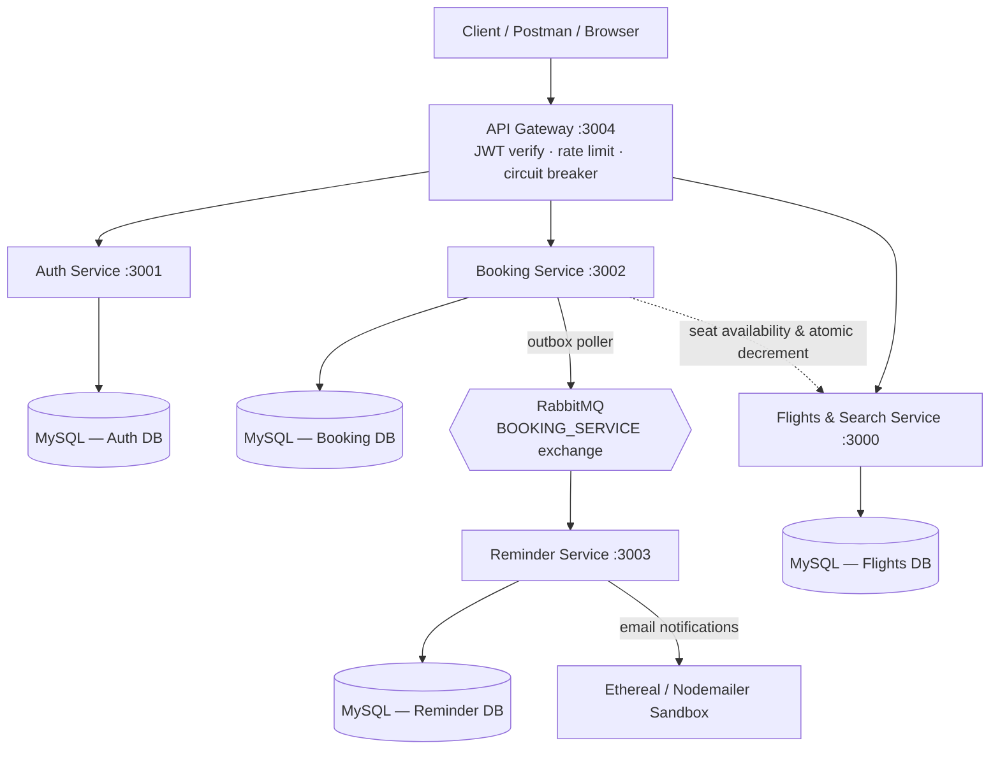
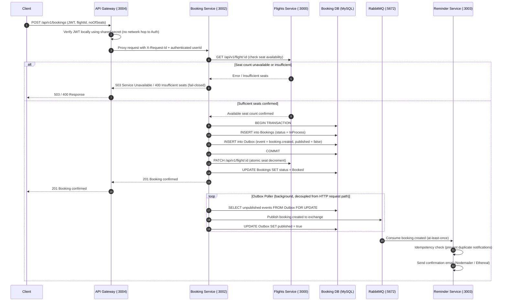
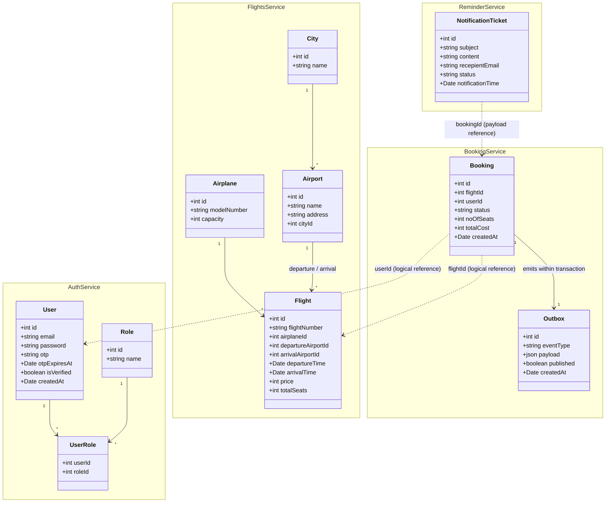

# ✈️ Airline Reservation & Management System (Microservices)

**A production-style distributed booking platform — built to solve the same consistency, coupling, and reliability problems real airline and e-commerce backends face at scale.**

[](https://expressjs.com/)
[](https://www.mysql.com/)
[](https://www.rabbitmq.com/)
[](https://sequelize.org/)
[](https://www.docker.com/)
[](#license)

---

### Highlights

- **5 independently deployable microservices** communicating over REST and an async AMQP message broker, each owning its own MySQL schema (database-per-service).
- **Single-command Docker Compose orchestration** running 7 containers (MySQL 8, RabbitMQ with Management UI, and 5 Node.js services) on an isolated bridge network with automated health checks.
- **Fail-closed seat reservation** — closes a real overbooking race condition present in naive check-then-decrement designs via atomic decrement and capacity validation.
- **Transactional outbox pattern** — database transaction atomically writes booking state and outbox events; a background poller ensures events are never lost during broker outages.
- **Circuit breaker + local JWT verification** at the API Gateway — no cascading downstream failures, no auth service in the latency hot path.
- **Correlation-ID tracing (`X-Request-Id`)** across every service boundary, without requiring an external distributed tracing stack.
- **Ownership-scoped authorization** enforced on every booking read and cancellation via verified JWT claims.
- **Comprehensive test suites** — Jest unit tests, automated end-to-end integration test runner, and concurrent booking race-condition verification.

---

## Table of Contents

- [Overview](#overview)
- [Architecture](#architecture)
- [Microservices](#microservices)
- [System Diagrams](#system-diagrams)
  - [End-to-End Booking Sequence](#end-to-end-booking-sequence-fail-closed-reservation--outbox-pattern)
  - [Domain Model Class Diagram](#domain-model-class-diagram)
- [Design Patterns & Principles](#design-patterns--principles)
- [Key Engineering Decisions](#key-engineering-decisions)
- [Tech Stack](#tech-stack)
- [API Overview](#api-overview)
- [Quick Start with Docker Compose](#quick-start-with-docker-compose-recommended)
- [Running Standalone on Host](#running-standalone-on-host-alternative)
- [Testing & Verification](#testing--verification)
- [Interview & Architectural Deep-Dive Guide](#interview--architectural-deep-dive-guide)
- [License](#license)

---

## Overview

This repository contains the complete microservices application stack, multi-container Docker Compose orchestration, automated migrations and seeders, end-to-end and concurrency test suites, and comprehensive interview documentation. Each microservice is also maintained in its own dedicated repository for independent versioning and CI/CD.

The system is deliberately scoped around the hardest problems a real booking platform has to solve: preventing overbooking under concurrent writes, guaranteeing a confirmed booking is never silently lost even if the message broker goes down, and keeping a single request traceable across five independently-deployed services without a shared database or a monolithic call stack.

---

## Architecture



---

## Microservices

| Service | Description | Container Port | Host Port | Repository |
|---|---|---|---|---|
| 🛡️ **API Gateway** | Single entry point for all client traffic. Local JWT verification, rate limiting, request proxying, circuit breaking (`opossum`), correlation-ID tracing. | `3004` | `3004` | [API_GATEWAY](https://github.com/Rohit-hub-coder/API_GATEWAY) |
| 🔐 **Auth Service** | User signup/signin, OTP email verification, JWT issuance with roles, bcrypt password hashing. | `3001` | `3001` | [auth-service](https://github.com/Rohit-hub-coder/auth-service) |
| 🎫 **Booking Service** | Booking creation, cancellation, status tracking, transactional outbox event publisher, and concurrency-safe seat reservation. | `3002` | `3002` | [booking-service](https://github.com/Rohit-hub-coder/booking-service) |
| ✈️ **Flights & Search** | Flight, airport, airplane, and city management with relational search and atomic seat inventory updates. | `3000` | `3000` | [FLIGHTSANDSEARCHSERVICE](https://github.com/Rohit-hub-coder/FLIGHTSANDSEARCHSERVICE) |
| 📢 **Reminder Service** | Asynchronous booking-confirmation notifications, driven by RabbitMQ with idempotent consumer and poller. | `3003` | `3003` | [ReminderService](https://github.com/Rohit-hub-coder/ReminderService) |

---

## System Diagrams

### End-to-End Booking Sequence (Fail-Closed Reservation + Outbox Pattern)

This is the system's core transaction, demonstrating how a synchronous, consistency-critical path (seat reservation) is composed with an asynchronous, at-least-once delivery path (notification), bridged by the transactional outbox pattern so a broker outage can never silently drop a confirmed booking.



### Domain Model Class Diagram

Each service manages its own isolated MySQL database schema (database-per-service pattern). Relationships spanning services use logical identifiers (`userId`, `flightId`) rather than database-enforced foreign keys.



---

## Design Patterns & Principles

| Pattern / Principle | Implementation & Location |
|---|---|
| **API Gateway** | Single public entry point (`:3004`), offloading token validation, rate limiting, and request routing from downstream services. |
| **Database-per-Service** | Each service owns an isolated MySQL schema (`auth_db_dev`, `flight_search_db_dev`, `booking_db_dev`, `reminder_db_dev`); zero cross-database queries or JOINs. |
| **Transactional Outbox** | In `BookingService`, booking creation and outbox entry are saved inside a single `sequelize.transaction()` block, preventing partial write states. |
| **Circuit Breaker** | API Gateway proxies to Flights via `opossum`, failing fast when error rate exceeds threshold to stop cascading latency. |
| **Fail-Closed Seat Reservation** | `BookingService` refuses to reserve seats if downstream seat availability cannot be explicitly verified. |
| **Event-Driven Asynchrony** | `ReminderService` reacts to `booking.created` events delivered via RabbitMQ exchange, completely decoupled from the synchronous HTTP booking flow. |
| **Role-Based Access Control** | `AuthService` issues signed JWTs with role claims (`Customer`, `admin`, `Airline_Business`), verified downstream. |
| **Distributed Tracing** | `X-Request-Id` header is assigned at API Gateway and forwarded across all intermediate service requests and logs. |

---

## Key Engineering Decisions

| Decision | Problem Solved | Trade-off Accepted |
|---|---|---|
| **Fail-closed seat reservation** | Prevents overbooking race conditions during concurrent booking requests. | A transient downstream network timeout rejects the booking rather than risking overselling inventory. |
| **Transactional outbox pattern** | Guarantees that a confirmed booking and its message broker notification event are never inconsistent. | Requires background polling loop and at-least-once delivery; consumer must be idempotent. |
| **Local JWT verification at Gateway** | Eliminates an extra network hop to Auth Service on every single authenticated request. | Immediate token revocation requires token blacklisting; otherwise valid until expiry. |
| **Isolated Docker Bridge Network** | Services communicate using Docker DNS (`auth-service`, `booking-service`, `mysql`, `rabbitmq`) without host port collisions. | Requires Docker environment configuration; host port `3307` used for MySQL to avoid host `3306` conflicts. |
| **Ownership-scoped access** | Prevents unauthorized users from reading or cancelling another user's booking via JWT user verification. | Rejects cross-user requests with `403 Forbidden`. |

---

## Tech Stack

| Layer | Technology |
|---|---|
| **Runtime & Framework** | Node.js (v20+ / v24), Express.js |
| **Databases & ORM** | MySQL 8.0, Sequelize ORM + Sequelize CLI migrations and seeders |
| **Message Broker** | RabbitMQ 3.13 (`amqplib`), AMQP exchange with transactional outbox publisher |
| **Authentication & Security** | JWT (`jsonwebtoken`), `bcrypt` password hashing, OTP generation |
| **Gateway & Resilience** | `http-proxy-middleware`, `express-rate-limit`, `opossum` circuit breaker, `helmet`, `cors` |
| **Email Transport** | Nodemailer with Ethereal disposable test sandbox |
| **Orchestration & DevOps** | Docker Compose (`compose.yaml`), isolated bridge networking, health checks |
| **Testing** | Jest, Supertest, custom asynchronous concurrency and E2E runners |

---

## API Overview

All client traffic routes through the API Gateway at `http://localhost:3004`.

| Method | Endpoint | Auth Required | Description |
|---|---|:---:|---|
| `POST` | `/api/v1/signup` | No | Register a new user account |
| `POST` | `/api/v1/signin` | No | Authenticate credentials and receive signed JWT |
| `POST` | `/api/v1/verify-otp` | No | Verify user signup via OTP |
| `GET` | `/api/v1/flight` | No | Search and filter flights with departure, arrival, and price |
| `GET` | `/api/v1/flight/:id` | No | Retrieve detailed information for a specific flight |
| `POST` | `/api/v1/bookings` | **Yes (JWT)** | Reserve seats and create a confirmed booking |
| `GET` | `/api/v1/bookings` | **Yes (JWT)** | List all bookings belonging to authenticated user |
| `GET` | `/api/v1/bookings/:id` | **Yes (JWT)** | Get booking details (owner only) |
| `PATCH` | `/api/v1/bookings/:id/cancel` | **Yes (JWT)** | Cancel booking and release reserved seats (owner only) |
| `GET` | `/api/v1/health` | No | API Gateway liveness check |
| `GET` | `/api/v1/health/aggregate` | No | Downstream aggregate health check across all services |

---

## Quick Start with Docker Compose (Recommended)

### 1. Prerequisites
- [Docker Desktop](https://www.docker.com/products/docker-desktop/) installed and running.
- Node.js v20+ (if running host-side verification scripts).

### 2. Configure Environment
Clone the repository and create the root `.env` file from the example:
```bash
git clone https://github.com/Rohit-hub-coder/airline-reservation-system.git
cd airline-reservation-system

# Copy the environment file
cp .env.docker.example .env
```

### 3. Start Application Stack
Build images and start all 7 containers in detached mode:
```bash
docker compose up -d --build
```

Verify that all containers report `Up (healthy)`:
```bash
docker compose ps
```

### 4. Run Database Migrations & Seeders
Execute the database setup script to migrate schemas and seed initial data across all services:

```powershell
# On Windows (PowerShell)
.\scripts\migrate-and-seed.ps1
```

```bash
# On Linux / macOS
docker compose exec -T auth-service npx sequelize-cli db:migrate
docker compose exec -T auth-service npx sequelize-cli db:seed:all
docker compose exec -T flight-service npx sequelize-cli db:migrate
docker compose exec -T flight-service npx sequelize-cli db:seed:all
docker compose exec -T flight-service node src/seeders/manual_flights_seeder.js
docker compose exec -T booking-service npx sequelize-cli db:migrate
docker compose exec -T reminder-service npx sequelize-cli db:migrate
```

### 5. Verify Health
Check aggregate downstream health through the API Gateway:
```bash
curl http://localhost:3004/api/v1/health/aggregate
```

Access the RabbitMQ Management Dashboard:
- URL: [http://localhost:15672](http://localhost:15672)
- Username: `guest`
- Password: `guest`

---

## Running Standalone on Host (Alternative)

To run the services without Docker containers on your local host:

1. Ensure MySQL 8 is running locally with databases: `auth_db_dev`, `flight_search_db_dev`, `booking_db_dev`, `reminder_db_dev`.
2. Start RabbitMQ via local broker or standalone container:
   ```bash
   docker run -d --name rabbitmq -p 5672:5672 -p 15672:15672 rabbitmq:3.13-management
   ```
3. In each service directory (`API_Gateway`, `AuthService`, `BookingService`, `FLIGHTSANDSEARCH`, `ReminderService`):
   ```bash
   npm install
   npm start
   ```

---

## Testing & Verification

### 1. End-to-End Acceptance Suite
Verifies health checks, flight catalog querying, user registration, OTP verification, authentication, booking creation, seat decrement verification, booking cancellation, seat restore, and unauthorized access guards:
```bash
node scripts/test-e2e.js
```

### 2. Concurrency Race-Condition Test
Simulates concurrent booking attempts targeting the same flight simultaneously to ensure the fail-closed seat decrement logic prevents overbooking:
```bash
node scripts/test-concurrency.js
```

### 3. Unit Tests (Booking Service)
Executes Jest test suites covering transaction boundaries, payment rollbacks, and seat availability validations:
```bash
docker compose exec booking-service npm test
```

---

## Interview & Architectural Deep-Dive Guide

For a comprehensive guide covering technical interview talking points, distributed transaction trade-offs, circuit breaker configurations, and outbox failure recovery modes, see:

📖 **[Full Technical Interview Guide (INTERVIEW_GUIDE.md)](INTERVIEW_GUIDE.md)**

---

## License

This project is licensed under the MIT License — see the [LICENSE](LICENSE) file for details.
