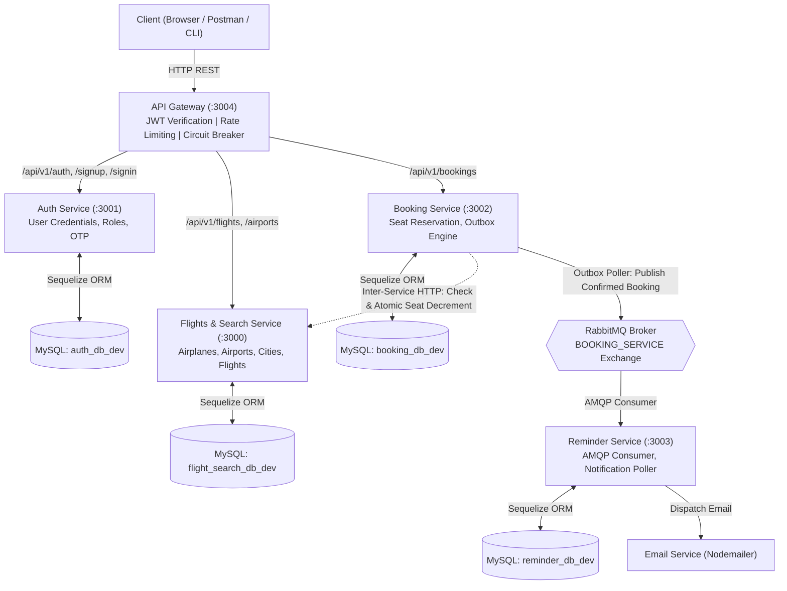
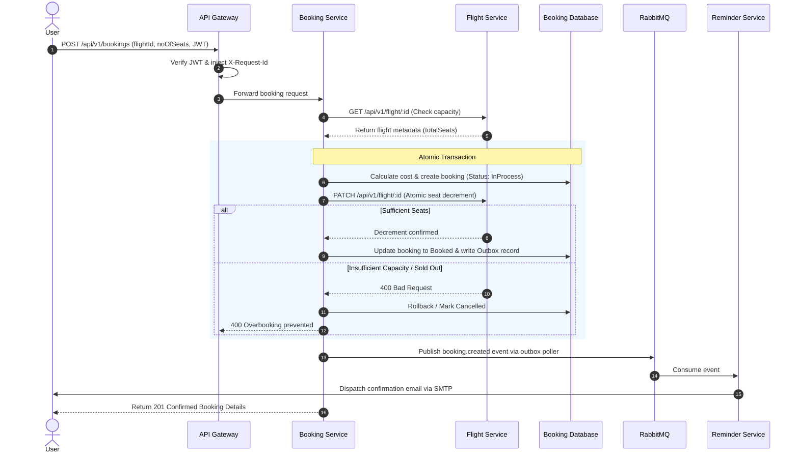

# Airline Management System

> Production-grade distributed airline booking and flight operations platform engineered with a microservices architecture, fail-closed concurrency control, asynchronous event-driven notifications via RabbitMQ, and centralized API Gateway orchestration.

[](https://nodejs.org/)
[](https://expressjs.com/)
[](https://www.mysql.com/)
[](https://sequelize.org/)
[](https://www.rabbitmq.com/)
[](https://www.docker.com/)
[](https://jestjs.io/)
[](LICENSE)

---

## Table of Contents

- [Problem & Motivation](#problem--motivation)
- [System Architecture](#system-architecture)
- [Microservices Overview](#microservices-overview)
- [Core Workflows](#core-workflows)
  - [Concurrency-Safe Booking Flow](#concurrency-safe-booking-flow)
  - [Transactional Outbox Pattern](#transactional-outbox-pattern)
- [Tech Stack](#tech-stack)
- [Project Structure](#project-structure)
- [Getting Started](#getting-started)
  - [Prerequisites](#prerequisites)
  - [Environment Setup](#environment-setup)
  - [Running with Docker Compose (Recommended)](#running-with-docker-compose-recommended)
  - [Running Standalone on Host](#running-standalone-on-host)
- [Environment Variables](#environment-variables)
- [API Endpoints](#api-endpoints)
- [Testing & Verification](#testing--verification)
- [Screenshots & Visuals](#screenshots--visuals)
- [Roadmap](#roadmap)
- [Author](#author)
- [License](#license)

---

## Problem & Motivation

Real-world reservation systems face distinct distributed systems challenges:
1. **Concurrency & Race Conditions**: High-volume booking surges (flash sales, seat allocation) can cause naive read-then-write systems to oversell inventory.
2. **Coupling & Reliability**: Directly coupling booking completion to external notification pipelines (email, SMS) introduces latency and risks booking failures if external dispatchers fail.
3. **Cascading Failures**: A bottleneck in flight lookups or user authentication shouldn't cascade into an unrecoverable system outage.
4. **Distributed Request Tracing**: Debugging issues across isolated services and independent databases requires unified request correlation.

This system addresses these challenges with **database-per-service isolation**, an **API Gateway with rate limiting and circuit breaking**, **atomic fail-closed inventory decrements**, and **asynchronous message queues with an outbox poller**.

---

## System Architecture



---

## Microservices Overview

| Service | Port (Container / Host) | Database | Primary Responsibility |
|---|:---:|---|---|
| **API Gateway** | `3004:3004` | None | Reverse proxy entry point, token verification, rate limiting (`express-rate-limit`), circuit breaking (`opossum`), correlation tracking (`X-Request-Id`). |
| **Auth Service** | `3001:3001` | `auth_db_dev` | User registration, password hashing (`bcrypt`), JWT generation/verification, role-based authorization, OTP generation and lifecycle cleanup. |
| **Flights & Search** | `3000:3000` | `flight_search_db_dev` | Flight schedule catalog, airport and airplane inventory, multi-criteria flight queries, and atomic seat availability decrement/restoration. |
| **Booking Service** | `3002:3002` | `booking_db_dev` | Transactional booking state management, seat reservation coordination, cancellation refunds, and transactional outbox persistence. |
| **Reminder Service** | `3003:3003` | `reminder_db_dev` | Asynchronous RabbitMQ consumer (`amqplib`), periodic background notification cron runner (`node-cron`), and email dispatching via Nodemailer. |

---

## Core Workflows

### Concurrency-Safe Booking Flow

To prevent race conditions where concurrent requests oversell remaining flight seats:



### Transactional Outbox Pattern

Rather than dual-writing directly to both MySQL and RabbitMQ (which risks inconsistency if the broker is unreachable), the Booking Service persists events into the transactional database schema. A resilient background poller scans for pending records, dispatches them to RabbitMQ, and marks them dispatched once acknowledged.

---

## Tech Stack

| Layer | Technology | Usage in Project |
|---|---|---|
| **Runtime** | Node.js (v18+) | Core JavaScript runtime across all services |
| **Web Framework** | Express.js 4.x | REST API routing and middleware pipelines |
| **Database** | MySQL 8.0 | Relational database (schema-per-service pattern) |
| **ORM** | Sequelize & Sequelize CLI | Models, relational associations, database migrations, and seeders |
| **Message Broker** | RabbitMQ (AMQP) | Asynchronous messaging between Booking and Reminder services |
| **API Gateway Patterns** | `http-proxy-middleware`, `opossum`, `express-rate-limit` | Routing, circuit breaking, and DDoS throttling |
| **Security & Auth** | `jsonwebtoken`, `bcrypt` | Stateless bearer token authentication, secure password hashing |
| **Notifications** | `nodemailer`, `node-cron` | Asynchronous email generation and scheduled reminder polling |
| **Containerization** | Docker, Docker Compose | Multi-container composition, health checking, bridge networking |
| **Testing** | Jest, Supertest | Unit test suites, mock verification, and integration validation |

---

## Project Structure

```text
airline-management-system/
├── API_Gateway/               # API Gateway service (port 3004)
│   ├── src/                   # Proxy logic, rate limiters, auth middleware
│   ├── Dockerfile
│   └── package.json
├── AuthService/               # Authentication & User Management (port 3001)
│   ├── src/                   # Controllers, models, migrations, seeders
│   ├── Dockerfile
│   └── package.json
├── BookingService/            # Flight Booking & Outbox Engine (port 3002)
│   ├── src/                   # Booking services, repositories, AMQP publisher
│   ├── tests/                 # Jest test suites
│   ├── Dockerfile
│   └── package.json
├── FLIGHTSANDSEARCH/          # Flights, Airports, Cities catalog (port 3000)
│   ├── src/                   # Flight CRUD, capacity validation, filters
│   ├── Dockerfile
│   └── package.json
├── ReminderService/           # Asynchronous Notification Service (port 3003)
│   ├── src/                   # AMQP consumer, cron poller, email sender
│   ├── Dockerfile
│   └── package.json
├── docker/                    # Docker initialization scripts
│   └── mysql/init.sql         # Automated database provisioning script
├── scripts/                   # Verification and testing automation
│   ├── migrate-and-seed.ps1   # PowerShell migration and seeder script
│   ├── test-concurrency.js    # Concurrency and race-condition simulator
│   └── test-e2e.js            # End-to-end integration test runner
├── .env.example               # Root environment variables template
├── compose.yaml               # Docker Compose orchestration manifest
└── LICENSE                    # MIT License
```

---

## Getting Started

### Prerequisites

- [Docker Desktop](https://www.docker.com/products/docker-desktop/) installed and running.
- [Node.js (v18+)](https://nodejs.org/) installed (for running host-side verification scripts).
- Git installed.

### Environment Setup

1. Clone the repository:
   ```bash
   git clone https://github.com/Rohit-hub-coder/airline-management-system.git
   cd airline-management-system
   ```

2. Create the root `.env` configuration file from the template:
   ```powershell
   # Windows PowerShell
   Copy-Item .env.example .env

   # Linux / macOS
   cp .env.example .env
   ```

---

### Running with Docker Compose (Recommended)

1. Build and boot all 7 containers (MySQL, RabbitMQ, and 5 Microservices):
   ```bash
   docker compose up -d --build
   ```

2. Verify that all containers report healthy:
   ```bash
   docker compose ps
   ```

3. Run automated database migrations and seeders across all services:
   ```powershell
   # Windows (PowerShell)
   .\scripts\migrate-and-seed.ps1
   ```
   *(Or on Linux/macOS, execute migrations through `docker compose exec` for each service).*

4. Verify aggregate system health:
   ```bash
   curl http://localhost:3004/api/v1/health/aggregate
   ```

5. Access the RabbitMQ Management UI:
   - URL: `http://localhost:15672`
   - Default User: `guest`
   - Default Password: `guest`

---

### Running Standalone on Host

1. Ensure MySQL 8 is running locally with four created databases:
   - `auth_db_dev`
   - `flight_search_db_dev`
   - `booking_db_dev`
   - `reminder_db_dev`
2. Start RabbitMQ locally (or run via standalone container: `docker run -d -p 5672:5672 -p 15672:15672 rabbitmq:3.13-management`).
3. For each service directory (`API_Gateway`, `AuthService`, `BookingService`, `FLIGHTSANDSEARCH`, `ReminderService`):
   ```bash
   npm install
   npm start
   ```

---

## Environment Variables

The system uses standard environment configurations. Configurable keys from `.env.example`:

| Variable Name | Default / Example | Purpose |
|---|---|---|
| `DB_PASSWORD` | `your_mysql_secure_password` | MySQL root password shared across databases |
| `HOST_MYSQL_PORT` | `3307` | Host port mapped to the MySQL container |
| `RABBITMQ_USER` | `guest` | Username for RabbitMQ broker |
| `RABBITMQ_PASS` | `guest` | Password for RabbitMQ broker |
| `JWT_KEY` | `your_shared_random_jwt_secret` | Secret key used to sign and verify JWT tokens |
| `EMAIL_USER` | `your_email@gmail.com` | Nodemailer sender email address |
| `EMAIL_PASS` | `your_gmail_app_password` | Nodemailer SMTP / Google App password |

---

## API Endpoints

All external requests route through the centralized API Gateway at `http://localhost:3004`.

| Service | Method | Route | Auth Required | Description |
|---|---|---|:---:|---|
| **Gateway** | `GET` | `/api/v1/health` | No | Gateway liveness health check |
| **Gateway** | `GET` | `/api/v1/health/aggregate` | No | Aggregate status check across all downstream services |
| **Auth** | `POST` | `/api/v1/signup` | No | Register a new customer user account |
| **Auth** | `POST` | `/api/v1/signin` | No | Authenticate user and obtain signed JWT |
| **Auth** | `POST` | `/api/v1/verify-otp` | No | Verify user registration with one-time passcode |
| **Flights** | `GET` | `/api/v1/flight` | No | Search flights with filters (departure, arrival, price) |
| **Flights** | `GET` | `/api/v1/flight/:id` | No | Retrieve detailed flight metadata and capacity |
| **Flights** | `POST` | `/api/v1/flight` | Yes (Admin) | Create a new flight entry |
| **Flights** | `GET` | `/api/v1/airport` | No | List airports |
| **Flights** | `GET` | `/api/v1/city` | No | List cities |
| **Booking** | `POST` | `/api/v1/bookings` | **Yes (JWT)** | Concurrency-safe seat reservation and booking creation |
| **Booking** | `GET` | `/api/v1/bookings` | **Yes (JWT)** | Fetch all bookings for the authenticated user |
| **Booking** | `GET` | `/api/v1/bookings/:id` | **Yes (JWT)** | Retrieve specific booking details (ownership verified) |
| **Booking** | `PATCH` | `/api/v1/bookings/:id/cancel` | **Yes (JWT)** | Cancel reservation and restore flight seat capacity |

---

## Testing & Verification

### 1. Booking Service Unit & Integration Tests (Jest)
Runs unit test suites covering transactional boundaries, validation, and seat state transitions:
```bash
# Inside BookingService folder or via Docker:
docker compose exec booking-service npm test
```

### 2. Concurrency Race-Condition Verification
Simulates concurrent, simultaneous booking requests attempting to book the same flight to verify that the atomic fail-closed reservation mechanism prevents overbooking:
```bash
node scripts/test-concurrency.js
```

### 3. End-to-End System Acceptance Flow
Executes full user flow: signup → signin → flight search → seat reservation → booking confirmation → cancellation:
```bash
node scripts/test-e2e.js
```

---

## Screenshots & Visuals

*Place visual assets under `docs/` to demonstrate live system operation:*

- `docs/architecture-overview.png`: Microservices topology and network diagram.
- `docs/rabbitmq-dashboard.png`: Active exchanges and message queues in RabbitMQ Management UI.
- `docs/concurrency-test-output.png`: Terminal output demonstrating overbooking rejection during concurrent load.
- `docs/e2e-test-results.png`: End-to-end acceptance script pass logs.

---

## Roadmap

- [ ] **Kubernetes Manifests**: Helm chart deployments for production cluster scaling.
- [ ] **Observability**: OpenTelemetry instrumentation with Prometheus metrics and Grafana dashboards.
- [ ] **Payment Gateway Webhook**: Integration with Stripe / Razorpay webhooks for asynchronous payment capture.
- [ ] **Distributed Caching**: Redis caching layer for high-throughput flight search queries.

---

## Author

**Rohit Kumar**  
Software Engineering Undergrad @ Delhi Technological University (DTU)  
- GitHub: [@Rohit-hub-coder](https://github.com/Rohit-hub-coder)  
- LinkedIn: [Rohit Kumar](https://linkedin.com/in/rohit-kumar-dtu)  
- Email: [dhimanrohit1003@gmail.com](mailto:dhimanrohit1003@gmail.com)

---

## License

This project is licensed under the [MIT License](LICENSE).
